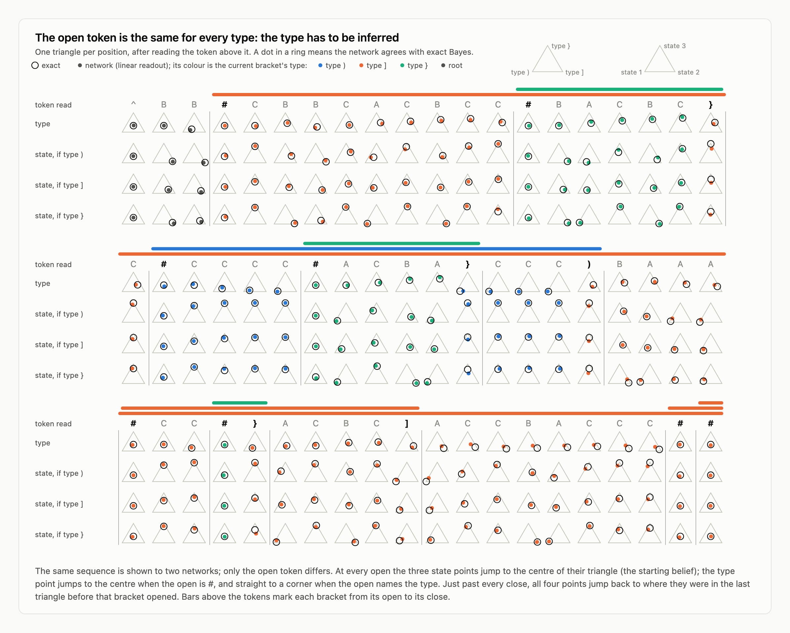
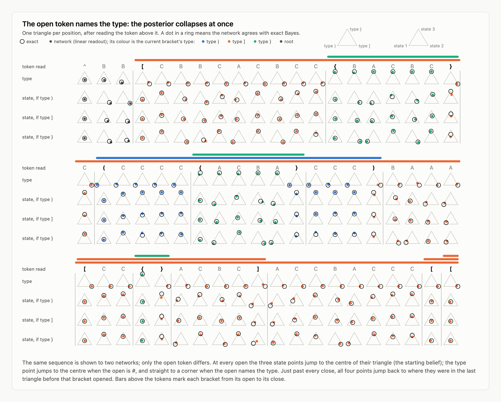
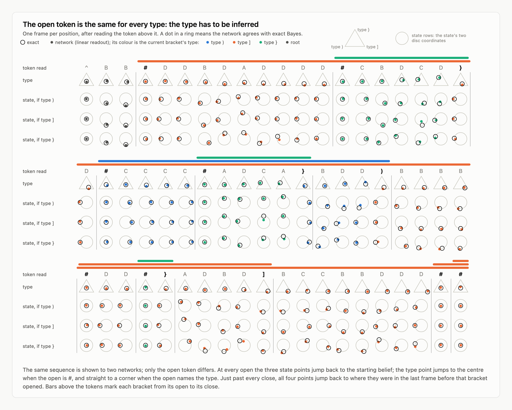
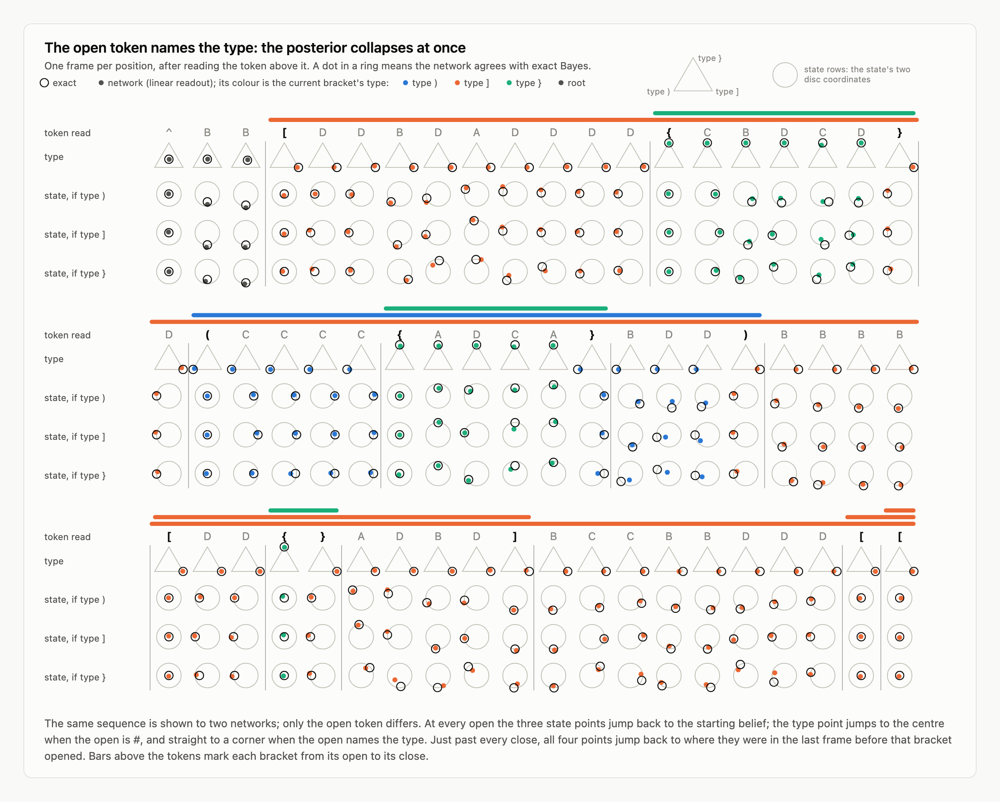
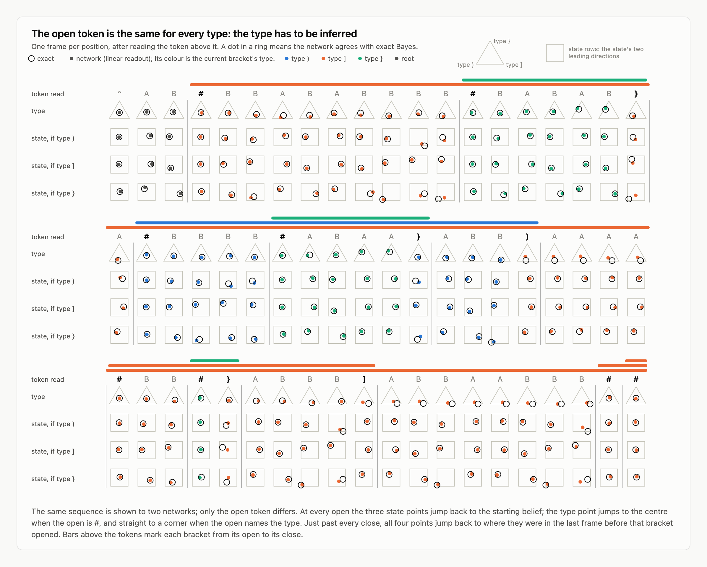
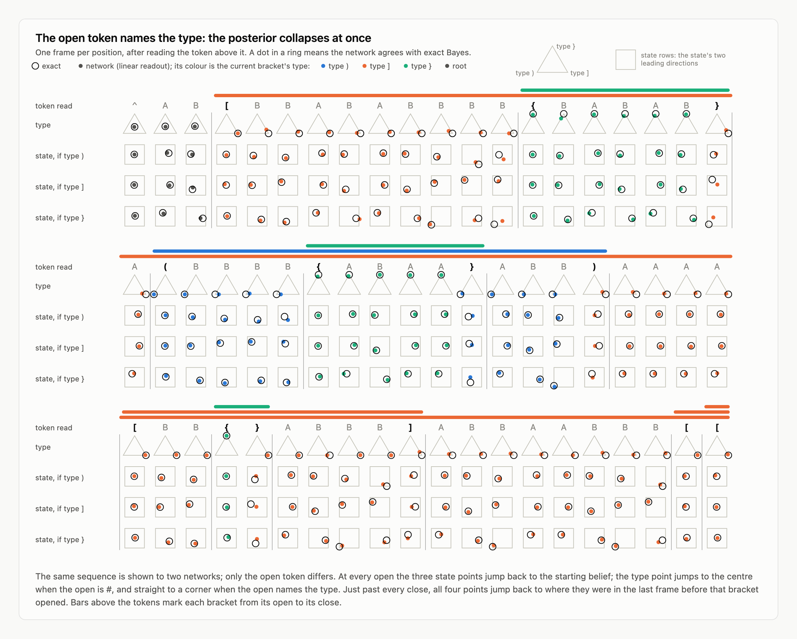

# Predicting a bracketed process without a stack

A proposal for how a transformer does exact next-token prediction on a process that needs a stack, an experiment that tests the proposal step by step, and a design study of which processes test it hardest.

Status: the algorithm is exact (checked against a stack-based Bayes filter on four process families). One small network, trained for 12 minutes on the Mess3 family, has been tested against it; everything under "Pilot" is that one seed. The design study involves no training.

## The process

There is a content vocabulary (`A B C`, or `A B C D`), an open bracket `#`, and K close brackets `) ] }`.

- Each `#` opens a bracket of hidden type, one of K, chosen uniformly.
- The content tokens directly inside a bracket are emitted by a component process chosen by the bracket's type. The K components share the vocabulary.
- A bracket closes with the close token of its type, so the type is revealed only at the end.
- Brackets nest. When a child closes, its parent's component continues from where it stopped.

Example: `#AA#BBB#C}B]A)`. The outer bracket emits `AA…A`, the middle one `BBB…B`, the inner one `C`.

To predict the next token one needs, for the bracket that is currently open, a belief over (type, component state). The full Bayesian state is one such belief per open bracket, so it grows with nesting depth. A recurrent filter keeps them on a stack. A transformer has no stack and no recurrence.

The pilot's process as a PCFG. `R(k,s)` is the root, which never closes; `X(k,s)` is an open bracket; `k` is the hidden type, `s` the hidden Mess3 state, `x` a content token, and `c_k` the close token of type `k`:

```
S       ->  R(k,s)                    1/9
R(k,s)  ->  x R(k,s')                 (1 - p_o) * T_k^x[s,s']
R(k,s)  ->  # X(j,u) R(k,s)           p_o / 9
X(k,s)  ->  x X(k,s')                 (1 - p_o - p_c) * T_k^x[s,s']
X(k,s)  ->  # X(j,u) X(k,s)           p_o / 9
X(k,s)  ->  c_k                       p_c
```

`T_k^x[s,s']` is the probability that the Mess3 of type `k` goes from state `s` to `s'` and emits `x`; `p_o = 0.10`, `p_c = 0.12`; no bracket opens at depth 8. The open token is the same for every type, so every push and pop is visible in the token itself (a visibly pushdown language) but the type is not.

Families of components (`process.FAMILIES`):

| name | components |
|---|---|
| `mess3` | Mess3 with (x, a) = (0.05, 0.85), (0.15, 0.6), (0.45, 0.85). The pilot. |
| `mess3_sharp` | Mess3 with (0.03, 0.9), (0.2, 0.8), (0.45, 0.9) |
| `clock3` | Mess3 (0.05, 0.75) whose state stays, advances by one, or advances by two each step |
| `tomq` | Tom Quantum with β/α = 0.364, 0.839, 2.747 (definition from simplexity). Four content tokens. |
| `fern` | FRDN (`fanizza` in simplexity) with (α, λ) = (2000, 0.49), (1.0, 0.49), (3.0, 0.45). Two content tokens; the belief depends on the count of the second token since the last first one. |
| `mess3_single` | one Mess3: nothing to infer about the type |
| any name + `+open` | K open tokens, so the type is visible from the start |

## The algorithm

Position `i` has read tokens `0..i-1` and predicts token `i`. Call the tokens directly inside one bracket its **thread**. The algorithm uses three operations, each of which one attention head can perform:

| operation | what it does | as attention |
|---|---|---|
| count | running sum over earlier positions | even attention |
| most recent | latest earlier position that matches a key | content match, tie broken by recency |
| gather | sum over earlier positions that share a tag | content match |

Seven steps. Each leaves one quantity at every position.

| step | quantity at position `i` | how |
|---|---|---|
| 1 depth | opens minus closes among the tokens read | count |
| 2 tag | position of the `#` that opened `i`'s bracket | most recent open whose depth equals `depth[i]` |
| 3 index | number of own-thread content tokens read | count over positions with the same tag |
| 4 state | for each type `k`, component `k`'s state belief | gather the thread's tokens, recency counted in thread tokens |
| 5 evidence | at each content token: `log P(token | thread so far, type k)` | local, from step 4 at the previous thread position |
| 6 type | log-posterior of the type | gather the thread's evidence, no decay |
| 7 belief | type posterior × state belief, then the next-token law | local |

Three properties follow.

- **One subspace, any depth.** The belief lives in the same K × S numbers at every position. A `#` does not move it to a new subspace; it changes the tag, and therefore which tokens feed it.
- **Nothing happens at a close.** The depth drops, step 2 returns the parent's tag, and steps 3–7 gather the parent's tokens again. No belief is stored and fetched.
- **Nothing is carried.** Inside a child, no position holds the parent's belief. The parent's tokens stay where they are.

Worked example (`python algorithm.py` prints it). Columns are positions; each has read the token shown (`^` is BOS).

```
read               ^    #    A    A    #    B    B    B    #    C    )    B    }    A
position           0    1    2    3    4    5    6    7    8    9   10   11   12   13
1 depth            0    1    1    1    2    2    2    2    3    3    2    2    1    1
2 tag (own #)      0    1    1    1    4    4    4    4    8    8    4    4    1    1
3 index            0    0    1    2    0    1    2    3    0    1    3    4    2    3
```

Position 10 has just read a close. Its depth is back to 2, the most recent `#` at depth 2 is position 4, so its tag is 4 and it gathers `BBB`.

`algorithm.py` implements these steps with the three operations only. It reproduces the stack filter to 1e-13 or better on 131,072 positions for each of `mess3`, `clock3`, `tomq`, `mess3+open` and `tomq+open`.

## What each position should hold

| the position has just read | depth | tag | index | belief subspace holds |
|---|---|---|---|---|
| a content token | unchanged | unchanged | +1 | own bracket's belief, updated |
| `#` | +1 | this position | 0 | the prior |
| a close | −1 | the parent's `#` | the parent's count | the parent's belief as of before the child |

## Shortcuts, and where each would show

A network could do something cheaper. `algorithm.py` implements the shortcuts below and prices them, in excess loss over Bayes (mnat/token), by position class. For the `mess3` family:

| | all | new bracket with an earlier one at its depth | just read a close | 1–3 tokens after a short child | 1–3 tokens after a long child |
|---|---|---|---|---|---|
| state from the last 4 own tokens only | 0.2 | 0.0 | 0.1 | 0.2 | 0.3 |
| state from the last 2 own tokens only | 3.6 | 0.0 | 3.3 | 4.2 | 4.4 |
| recency counted in positions, not thread tokens | 2.1 | 0.0 | 2.0 | 5.7 | 14.4 |
| depth tag only, no bracket tag | 46.2 | 140.6 | 41.5 | 35.9 | 28.8 |
| no reset at an open (reads enclosing brackets too) | 258.1 | 499.0 | 227.7 | 218.2 | 166.9 |
| no type inference | 46.1 | 4.7 | 44.3 | 56.2 | 53.1 |
| keeps the type, forgets the state at a close | 7.7 | 0.0 | 57.3 | 15.1 | 16.0 |
| forgets the parent at a close | 18.7 | 0.0 | 71.7 | 51.3 | 50.5 |

## The experiment

Train a small causal transformer on the process (`train.py`), then run `validate.py`. It makes six measurements, each with a prediction from the algorithm.

1. **Loss.** Excess loss over Bayes in the position classes above. Prediction: near zero in every column, flat in depth.
2. **Probes.** Linear readout of each step's quantity from the residual after each block, with an untrained network as control. Prediction: the quantities become readable in the order of the steps, and the parent's belief is never readable at a child's positions.
3. **Attention.** For each head, the share of attention by what the attended position is to the current one: own thread, own `#`, inside closed children, enclosing brackets, earlier brackets. Prediction: even-spread heads early (the count), then heads that read only the own thread, including just after a close, when the thread sits behind the child. A second test asks whether recency is counted in thread tokens or in positions.
4. **Patching.** After a close at `q`, change the parent's earlier tokens `R` (all but the last one before the child, at `p`). Overwrite the residual after one block at one set of positions with its value in the changed run, and measure what fraction of the change in `q`'s prediction results. Prediction: nothing travels through the child, or reaches `q` before the last block; `p` carries only its own evidence term, a minority share that the algorithm itself predicts.
5. **Types.** Step 4 keeps a state belief for every type at once. Prediction: each type's state belief has its own subspace, the same at every depth, and it is filled whether or not that type is likely. Measured by one joint regression of the residual on all types' beliefs.
6. **Invariance.** Exact prediction does not depend on the tokens of enclosing brackets, or on the content of brackets that have closed. Change those tokens and measure how far the network's prediction moves. Prediction: not at all. This is the direct test that the belief is refreshed at every open and that nothing leaks back at a close.

## Pilot

One seed on `mess3`: 4 layers, d = 128, 4 heads, context 128, batch 64, 8,000 steps, 12 minutes on a laptop GPU. Evaluated on 768 held-out sequences.

**1. Loss** (mnat/token): 2.5 over all positions; 0.3 in new brackets with an earlier one at the same depth (depth-only tagging would give 140.6); 6.1 just after a close (forgetting the parent would give 71.7); 3.7 and 5.5 after short and long children. By depth 0 to 6: 2.1, 2.2, 2.4, 3.3, 2.7, 3.2, 3.9, a mild rise.

**2. Probes** (R² on held-out sequences):

| quantity | emb | blk 1 | blk 2 | blk 3 | blk 4 | best untrained |
|---|---|---|---|---|---|---|
| 1 depth | 0.11 | 0.95 | 0.99 | 0.99 | 0.98 | 0.21 |
| 2 tag (distance back to own `#`) | 0.15 | 0.19 | 0.57 | 0.84 | 0.82 | 0.15 |
| 3 index | 0.13 | 0.41 | 0.67 | 0.86 | 0.86 | 0.17 |
| 4 state belief per type | 0.78 | 0.80 | 0.87 | 0.91 | 0.93 | 0.79 |
| 5 evidence of the token just read | 0.00 | 0.00 | 0.72 | 0.88 | 0.89 | 0.00 |
| 6 type log-posterior | 0.00 | 0.03 | 0.25 | 0.35 | 0.82 | 0.01 |
| 7 belief of the own bracket | 0.31 | 0.33 | 0.48 | 0.55 | 0.84 | 0.32 |
| belief of the parent bracket | 0.00 | 0.03 | 0.04 | 0.12 | 0.10 | 0.02 |

The order matches the steps: depth after block 1, tag and index over blocks 2–3, evidence from block 2, type and belief at block 4. The state row is weak evidence, because the last token alone predicts most of the state (0.78 from the embedding).

**3. Attention.** All four block-1 heads match even spread to within 0.03. Just after a close with at least three own tokens behind the child (2,817 positions; even spread would put 0.12 on own tokens, 0.24 inside closed children, 0.38 on enclosing brackets):

| head | own tokens | own `#` | inside closed children | enclosing brackets |
|---|---|---|---|---|
| block 4 head 1 | 0.90 | 0.05 | 0.03 | 0.01 |
| block 4 head 3 | 0.73 | 0.16 | 0.03 | 0.01 |
| block 4 head 2 | 0.64 | 0.27 | 0.03 | 0.01 |
| block 3 head 0 | 0.49 | 0.02 | 0.08 | 0.17 |

Recency test on the three block-4 readers (share of attention on the third most recent own token, relative to the second): head 1 gives 0.47 with no child in between, 0.45 with a short child, 0.45 with a long one, as counting in thread tokens predicts. Heads 2 and 3 shift, in opposite directions (0.54, 0.52, 0.67 and 0.52, 0.39, 0.36).

**4. Patching** (712 events; the change moves the Bayes law at `q` by 160 mnat; the network's change has cosine 0.95 with the Bayes change):

| patched after | embedding | block 1 | block 2 | block 3 |
|---|---|---|---|---|
| `R`, the changed tokens | 1.00 | 1.00 | 0.81 | 0.76 |
| `p`, last own token before the child | 0.00 | 0.00 | 0.18 | 0.21 |
| everything else before `q` | 0.00 | 0.00 | 0.00 | 0.00 |
| `q` itself | 0.00 | 0.00 | 0.00 | 0.01 |

The same patch applied to the algorithm after its evidence step gives `R` 0.75 and `p` 0.29. So block 4 reads the parent's information from the parent's own token positions, nothing passes through the child, and the share at `p` is about what its evidence term accounts for.

**5. Types.** After block 3 the three types' state-belief subspaces are nearly separate: overlaps 0.13, 0.12, 0.16 (chance 0.02; an untrained network gives 0.93–0.98, because there everything sits in the last token's embedding). After block 4 they have partly merged: 0.92, 0.49, 0.62. The same type's subspace at depth ≤ 1 and depth ≥ 2 overlaps 0.58, 0.92, 0.98 after block 3 and 0.93, 0.99, 0.99 after block 4. A type's state belief is read as well where that type is unlikely (posterior below 0.1: R² 0.94) as where it is likely (0.95). Caveat: in `mess3` two of the three types' beliefs are almost linear functions of the others (R² 0.97), so these subspaces are poorly identified; `clock3` (0.38) and `tomq` (0.49–0.77) are better for this test.

**6. Invariance** (KL in mnat between the network's predictions before and after the change):

| change | where it should not matter | where it should (exact / network) |
|---|---|---|
| root bracket's tokens | 0.1 at depth ≥ 1 | 140.8 / 140.6 at depth 0 |
| tokens at depth ≤ 1 | 0.1 at depth ≥ 2 | 143.5 / 143.1 at depth ≤ 1 |
| content of a closed bracket | 0.1 after its close | 138.3 / 134.8 inside it |

**Training order.** In the old-format log, the extra loss in resumed brackets over fresh ones was 27 mnat at step 1,000 (forgetting the parent costs 40), 15 at step 1,500 and 3 at the end. So filtering within a bracket was learned before resuming after a close.

**Not explained.**
- Block 2 head 2 puts 0.38 of its attention on the previous position in the thread overall, but just after a close it reads inside the closed child (0.70) and not the thread's previous position (0.02).
- Block 4 head 0 puts 0.21–0.27 on brackets that closed before the current one opened.
- The parent's belief is faintly readable at child positions (0.10, control 0.02), although patching shows nothing passing through the child.
- A probe fitted only at depth ≤ 1 fails at depth ≥ 3, while one probe fitted on all depths works at each. Not followed up.

## Figures from the pilot

`python figures.py runs/pilot_d128_L4_T128_s0` writes `figures/report.html` (self-contained, with the grammar above) and `bash export.sh` turns the figures into PNGs. Numbers behind them are in `figures/data.json`.

**Three state beliefs at once, one plane each.** For every bracket the network holds a Mess3 belief for each possible type.


**The belief is refreshed at every open, and returns at a close.** Read two ways: linearly from the last block, and from the network's own close-token probabilities.


**Positions are tagged by depth and by bracket, and attention follows the bracket.**


**One sequence, belief by belief** (`python example.py RUN_HIDDEN RUN_OPEN`, written to `figures/example.html`). The two processes differ only in the open token, so both networks are shown the same sequence. Each column is a position; rows are the type posterior of the current bracket and the state belief under each type, exact and as read from the network. The sequence was picked from 6,000 samples for having brackets of different types opened inside one another; the networks are the 20,000-step `mess3` and `mess3+open` runs.

One small frame per position and per belief: a ring for exact Bayes, a dot for the network's linear readout, coloured by the current bracket's type. At an open the points jump to the starting belief; just past a close they jump back to where they were before that bracket opened.





The same for Tom Quantum (6 layers; the state is drawn in a disc) and fern (4 layers; the state is drawn in its two leading directions). `python example.py RUN_HIDDEN RUN_OPEN SEED PREFIX` makes each pair.









Two other views of the Mess3 sequence: the belief's path through each stretch between brackets, as an arrowed line in one larger triangle (`figures/example_paths_hidden.png`, `example_paths_open.png`), and rows of shaded cells that also show the type read from the network's own close-token probabilities (`figures/example_hidden.png`, `example_open.png`).

## Which processes to train on

A process is informative about a step when skipping that step is expensive, because then a network's loss shows whether the step is done. `design.py` prices every shortcut for every family (512 sequences each, no training). Excess loss in mnat/token; the pilot network reached 2.5, so differences of 5–10 are readable from a run of that size.

| process | all inference is worth | last 4 own tokens only | last 2 | position clock | position clock, after a long child | depth tag only | no type inference | forget state at a close | forget parent at a close |
|---|---|---|---|---|---|---|---|---|---|
| `mess3` | 74 | 0.2 | 3.6 | 2.1 | 13.5 | 48.7 | 46.5 | 56.4 | 72.4 |
| `mess3_sharp` | 127 | 0.2 | 4.7 | 2.5 | 17.1 | 85.7 | 77.9 | 102.3 | 124.7 |
| `clock3` | 97 | 1.7 | 13.6 | 6.6 | 31.6 | 68.0 | 73.9 | 74.2 | 96.8 |
| `tomq` | 115 | 4.4 | 12.5 | 4.5 | 19.5 | 79.0 | 28.6 | 102.5 | 115.0 |
| `mess3+open` | 166 | 0.2 | 3.6 | 1.2 | 8.9 | 6.5 | 16.1 | 76.4 | 161.7 |
| `tomq+open` | 207 | 4.6 | 13.2 | 3.6 | 17.8 | 30.7 | 10.3 | 119.1 | 204.4 |
| `mess3_single` | 217 | 0.6 | 11.3 | 2.5 | 22.8 | 20.4 | 0.0 | 214.3 | 214.3 |

Reading it by step:

- **Step 4, how far back the state gather reaches.** Mess3 needs about three own tokens (using four costs 0.2). Tom Quantum needs about eight (using four costs 4.4). So `tomq` tests whether the gather really runs back through the thread and across children; `mess3` barely does.
- **Step 3, counting in thread tokens.** `clock3` is the hardest: counting in positions costs 31.6 just after a long child, against 13.5 for `mess3`.
- **Step 2, the bracket tag.** Expensive to skip in every hidden-type family (49 to 86 overall). It becomes cheap when the open token shows the type (6.5 for `mess3+open`), so a `+open` network has little reason to build the tag.
- **Steps 5–6, type inference.** Worth 47 to 78 in the Mess3 families, 29 in `tomq`, and absent in `+open`, which makes `+open` the control: the evidence and type probes should find nothing there.
- **The close.** Forgetting the parent costs most when the type is known (162 to 214 in `+open` and single-type processes).

- **Per-type subspaces.** How much of one type's state belief the other types' beliefs predict linearly: 0.97, 0.97, 0.64 in `mess3`; 0.38 for every type in `clock3`; 0.65, 0.77, 0.49 in `tomq`. The lower, the better the per-type subspaces can be told apart.

`mess3_slow` (not shown) is uninformative: all inference is worth 18 mnat and the types are barely distinguishable.

**Coupled brackets** are the first step outside the class. `coupled.py` makes a child's type depend on its parent's, checks that the active bracket's belief is still an exact local statistic (brute-force enumeration, 1.3e-14), and prices observers that chain only a limited number of reads. With the close token revealing the type and the child sharing its parent's type with probability 0.9:

| observer | all | new bracket at depth ≥ 2 |
|---|---|---|
| ignores the coupling | 62.7 | 99.9 |
| uses each child's revealed type | 39.5 | 82.6 |
| + prior from the parent, 1 read down | 11.2 | 38.0 |
| + 2 reads down | 3.3 | 10.8 |
| + 3 reads down | 0.9 | 3.2 |

The prediction was that each extra read costs a layer, so that a sweep over depth would land on this ladder of loss floors. The overnight runs below refuted that for this coupling. At coupling 0.5 the ladder is too short to see (8.4, 0.9, 0.1). If the type is never revealed, every truncation costs under 10 mnat at 0.9 and under 3 at 0.5, and limiting the reads up costs under 1: not worth training.

**Suggested order.** `tomq` (a different geometry and the longest gather), `clock3` (the thread clock), `mess3+open` (the control without type inference), then coupled brackets at 0.9 with revealed types over 3 to 6 layers. Whether each component's belief can be read from one block is checked in the next section.

## Overnight runs (12 November)

20,000 steps, batch 64, context 128, one network per row. Excess loss over Bayes in mnat/token. `python summary.py` prints one line per run from `runs/*.validate.txt`, which hold the six measurements for each.

**Other families** (d = 128):

| run | layers | all | new bracket with an earlier one at its depth | just read a close | 1–3 tokens after a long child | belief readout R², last block |
|---|---|---|---|---|---|---|
| `mess3`, seed 1 | 4 | 1.2 | 0.1 | 2.5 | 2.7 | 0.88 |
| `clock3`, seed 0 | 4 | 1.8 | 0.1 | 4.9 | 3.6 | 0.89 |
| `clock3`, seed 1 | 4 | 2.8 | 0.1 | 6.4 | 7.3 | 0.88 |
| `mess3+open` | 4 | 0.8 | 0.2 | 2.4 | 1.5 | 0.92 |
| `fern` | 4 | 4.6 | 0.1 | 10.2 | 11.9 | 0.75 |
| `tomq`, seed 0 | 6 | 7.0 | 0.1 | 7.7 | 8.4 | 0.67 |
| `tomq`, seed 1 | 6 | 4.7 | 0.1 | 5.9 | 6.4 | 0.72 |
| `tomq` | 4 | 8.0 | 0.1 | 11.5 | 13.5 | 0.65 |
| `tomq+open` | 6 | 4.0 | 0.2 | 5.6 | 5.6 | 0.82 |

- **Brackets are kept apart in every family.** In new brackets that have an earlier one at the same depth the excess is 0.1–0.2, where a depth tag alone would cost 140–250. Changing tokens outside the current bracket moves predictions by at most 0.1 mnat in every d = 128 run.
- **The clock networks count in thread tokens.** After a long child they are at 3.6 and 7.3; counting in positions would cost 31.
- **Per-type subspaces are clearer here than in the pilot.** One block before the last, the overlap between two types' planes is 0.07–0.12 in `clock3` and 0.00–0.12 in `tomq` (chance 0.02), and the same type's plane at shallow and deep positions overlaps 0.96–0.99. After the last block the `clock3` planes have partly merged (0.43–0.44).
- **Patching matches the algorithm's own split.** After a close, the share of the effect carried by the parent's earlier tokens and by the last position before the child is 0.79 / 0.22 in `fern` (algorithm 0.79 / 0.22), 0.79 / 0.18 in `mess3` (0.75 / 0.29), 0.58 / 0.25 in `clock3` (0.73 / 0.32), 0.66–0.72 / 0.21–0.30 in `tomq` (0.82 / 0.18), and nothing passes through anything else.
- **Tom Quantum is the hardest.** Six layers beat four after a close (8.4 against 13.5 after a long child) but the networks are still 5–7 mnat from Bayes, worst in the root (7–11 at depth 0), and the belief reads only 0.65–0.72 from the last block.
- **The type-at-open control is confounded by the root.** The root's type is still hidden, and the per-token evidence is still readable in `mess3+open` (0.84).

**Width sweep** (`mess3`, 4 layers, two seeds). A full depth-8 stack of beliefs is 81 numbers.

| d | all | by depth 0, 3, 6 (seed 0) | by depth 0, 3, 6 (seed 1) | largest leak |
|---|---|---|---|---|
| 128 | 1.2 | – | 1.1, 1.3, 1.7 | 0.0 |
| 64 | 2.3, 2.2 | 1.9, 3.0, 3.7 | 1.8, 2.5, 3.4 | 0.2 |
| 32 | 4.5, 5.0 | 3.6, 5.6, 6.6 | 3.8, 5.8, 8.2 | 0.3 |
| 16 | 9.5, 10.0 | 6.2, 9.7, 20.0 | 6.8, 10.7, 18.0 | 0.6 |

At d = 32, less than half of what a full stack needs, the network is within 4–8 mnat of Bayes at every depth, where forgetting the parent costs 19 overall and 73 just after a close. The loss does rise with depth as width shrinks: by a factor of two at d = 32 and three at d = 16. `clock3` at d = 32 is much worse (14.5 overall, 33 after a long child).

**Coupled brackets** (child shares its parent's type with probability 0.9; `coupled_train.py`):

| | all | new bracket at depth ≥ 2 | just read a close |
|---|---|---|---|
| observer with 0 reads of the parent | 38.9 | 79.7 | 8.0 |
| 1 read | 11.9 | 37.1 | 2.3 |
| 2 reads | 3.6 | 11.0 | 0.7 |
| 3 reads | 1.1 | 3.3 | 0.2 |
| network, 2 layers | 2.6 | 3.3 | 5.2 |
| network, 3 layers | 2.0 | 2.4 | 3.9 |
| network, 4 layers | 1.4 | 1.7 | 2.8 |
| network, 6 layers | 0.8 | 0.9 | 1.8 |

The prediction that loss would step down a ladder as layers allow more chained reads is wrong here. A two-layer network is already below the two-read floor, and in new brackets at depth ≥ 2 it is at 3.3 where two reads give 11.0. The likely reason, not yet tested: with this coupling a type is either copied from the parent or redrawn, so the evidence of all enclosing brackets about a shared type simply adds, and one gather over the enclosing brackets' tokens replaces the chain. A coupling whose steps do not commute would be needed to test the layer cost.

Tested on 12 November (`coupled_gather.py`, same evaluation set). The chain of reads is a filter run along the path from the root: the hidden chain is the types of the enclosing brackets, and each bracket's evidence is one soft observation. Flat belief updating is the same kind of chain and transformers do not spend a layer per token on it, so the question is whether one gather can stand in for this chain too. An observer that never chains, and instead adds up the evidence of all enclosing brackets with weight γ^(levels up − 1) before applying the coupling once:

| observer | all | new bracket, depth ≥ 2 | just read a close |
|---|---|---|---|
| 2 chained reads | 3.56 | 11.04 | 0.67 |
| 3 chained reads | 1.09 | 3.28 | 0.23 |
| one gather, γ = 0.3 | 3.00 | 9.06 | 0.65 |
| one gather, γ = 0.5 | 1.71 | 5.14 | 0.48 |
| one gather, γ = 0.7 | 2.75 | 8.43 | 0.77 |
| one gather, γ = 1 (all enclosing brackets share one type) | 6.42 | 19.72 | 1.55 |

A single weighted gather lands between two and three chained reads. The networks do better still where the chain matters most (new brackets at depth ≥ 2: 3.3, 2.4, 1.7, 0.9 at 2, 3, 4, 6 layers), so they are not limited to one weighted sum; gathering several enclosing brackets separately and combining them would do it. Either way the chain is being done at once and not one level per layer.

## Is each component's belief readable from one block?

The probes above read a belief from one block's output. That only makes sense for components whose belief is linearly readable from a single block of a trained network, which is known to fail for RRXOR (Shai et al., arXiv 2405.15943). `flat.py` trains a network on one component alone, on flat sequences with no brackets, and reads the belief from each block. d = 64, 4 heads, context 32, one seed each.

Four layers, 15,000 steps:

| component | excess loss, mnat/token | readout R², last block | all blocks together | untrained, last block |
|---|---|---|---|---|
| Mess3 (0.05, 0.85) | 0.05 | 0.998 | 0.999 | 0.876 |
| clock (Mess3 advancing by one) | 0.10 | 0.995 | 0.998 | 0.669 |
| fern (2000, 0.49) | 0.01 | 0.990 | 0.998 | 0.601 |
| Tom Quantum, β/α = 0.364 | 0.35 | 0.982 | 0.995 | 0.668 |
| Tom Quantum, β/α = 2.747 | 1.44 | 0.964 | 0.982 | 0.440 |
| Tom Quantum, β/α = √51 | 4.20, still falling | 0.622 | 0.628 | 0.128 |
| RRXOR | 0.01 | 0.669 | 0.799 | 0.091 |

- RRXOR is the control: the network solves it, yet the belief is not readable from one block.
- Mess3, the clock, fern and Tom Quantum at the settings used in the `tomq` family pass. Tom Quantum at β/α = √51 (reported as the Bloch Walk setting of arXiv 2507.07432) does not at this budget; its belief has a slowly decaying component that changes sign every step.

A stricter question, whether a one-layer network can hold the belief at all (20,000 steps):

| component | excess loss, mnat/token | readout R² after the layer |
|---|---|---|
| Mess3 (0.05, 0.85) | 0.15 | 0.996 |
| clock | 0.21 | 0.995 |
| Tom Quantum, β/α = 0.839 | 0.19 | 0.986 (the last token alone gives 0.971) |
| fern (2000, 0.49) | 0.73 | 0.921 |
| Tom Quantum, β/α = 0.364 | 2.47 | 0.902 |
| Tom Quantum, β/α = 2.747 | 11.5 | 0.859 |
| Tom Quantum, β/α = √51 | 8.4, on a plateau | 0.240 |
| RRXOR | 54 | 0.241 |

For Tom Quantum at β/α = 2.747 one layer is a real limit: three times the training gives 7.2 mnat and 0.82, while two layers give 4.0 mnat and 0.93. So a bracket network on `tomq` needs layers for the component's own filtering on top of the bracket bookkeeping; six is a safer choice than the pilot's four.

## How the probes are fitted, and whether one map serves every depth

Every probe above is one linear map fitted on all positions at once: from a block's output to the active bracket's state belief under each type hypothesis (9 numbers for Mess3), whatever the depth and whatever the bracket's true type. A high pooled R² could still hide a map that works at some depths and not others. `transfer.py` checks that on four hidden-type networks (`night_d128_L4_T128_s1`, `clock3_night_d128_L4_T128_s0`, `tomq_night_d128_L6_T128_s1`, `fern_night_d128_L4_T128_s0`), with 1,536 fresh sequences, probes fitted on 1,152 and tested on the rest. Outputs are in `runs/NAME.transfer.txt`.

**One map reads every depth.** R² of the pooled probe after the last block, by the depth of the tested position, beside a probe fitted at that depth only:

| | depth 0 | 1 | 2 | 3 | ≥ 4 |
|---|---|---|---|---|---|
| Mess3, pooled | 0.946 | 0.947 | 0.946 | 0.946 | 0.944 |
| Mess3, fitted at that depth | 0.951 | 0.950 | 0.950 | 0.950 | 0.949 |
| clock, pooled | 0.932 | 0.928 | 0.925 | 0.925 | 0.922 |
| clock, fitted at that depth | 0.942 | 0.934 | 0.932 | 0.932 | 0.930 |
| Tom Quantum, pooled | 0.796 | 0.887 | 0.893 | 0.865 | 0.874 |
| Tom Quantum, fitted at that depth | 0.803 | 0.891 | 0.897 | 0.869 | 0.880 |
| fern, pooled | 0.843 | 0.864 | 0.855 | 0.849 | 0.837 |
| fern, fitted at that depth | 0.863 | 0.874 | 0.867 | 0.861 | 0.854 |

Sharing one map across depths costs at most 0.02.

**Subspaces fitted separately at each depth coincide, except for fern's root.** For each depth alone, regress the residual on all types' state beliefs and the type posterior, and keep each type's S − 1 directions (the construction of measurement 5). Overlap between two depths, mean over types, after the last block:

| | between any two depths | same depth, two halves of the data | between two types |
|---|---|---|---|
| Mess3 | 0.95–0.99 | 0.99 | 0.81 |
| clock | 0.98–1.00 | 1.00 | 0.44 |
| Tom Quantum | 0.95–0.99 | 1.00 | 0.13 |
| fern, depths ≥ 1 | 0.94–0.96 | 0.97 | 0.53 |
| fern, root against depth ≥ 1 | 0.46–0.50 | | |

In fern the root bracket's state belief is written along different directions from a nested bracket's. The root is a different nonterminal (it never closes), so this does not break the requirement that a subspace mean the same thing everywhere, but it is one more way the root is special.

**A probe fitted at one depth is not the shared map.** Fitted at depth 1 only and tested at depth 2, the Mess3 probe gives 0.931; tested at depth 0 it gives −1.37. Re-estimating only its constant at the tested depth gives 0.945 and 0.844. So among depths 1 to 3 the directions transfer and mostly a constant differs; between the root and nested brackets more differs. My reading, not tested: a probe fitted at one depth is free to put weight on directions that are quiet at that depth and carry depth or the bracket tag elsewhere. This is why the comparison above uses the directions the belief is written along and not probe weights.

**Across type.** Is type k's state belief read by the same map whether or not the bracket is likely to be type k? One block before the last, yes: for Mess3 a probe fitted only where k is likely (posterior > 0.5) gives 0.889 where k is unlikely (< 0.1), against 0.914 for a probe fitted there. After the last block, no: 0.577 against 0.948 (clock 0.711 against 0.919, Tom Quantum 0.368 against 0.706, fern 0.633 against 0.852). That fits the planes merging in the last block: where k is likely, type k's belief nearly equals the bracket's mixed belief, which the last block writes for the prediction, and a probe fitted only there can read the mixture.

## Does a nested position still hold the enclosing brackets' beliefs?

Measurement 6 shows that changing an enclosing bracket's tokens does not change the prediction inside a child. That leaves two pictures. In the algorithm's, a position inside a child holds only the child's belief, and the parent's is rebuilt from the parent's tokens at the close. In the other, every position carries the running beliefs of all enclosing brackets and uses one. `ancestors.py` probes for the second: from positions inside a bracket, read the parent's belief as it stood when the bracket opened, which is what the close will need. R² after the last block (outputs in `runs/NAME.ancestors.txt`):

| read from positions inside a bracket | Mess3 | clock | Tom Quantum | fern |
|---|---|---|---|---|
| own bracket, state per type | 0.95 | 0.93 | 0.88 | 0.86 |
| own bracket, type | 0.96 | 0.95 | 0.85 | 0.82 |
| parent, state per type | 0.19 | 0.25 | 0.12 | 0.03 |
| parent, type | 0.05 | 0.01 | 0.02 | 0.05 |
| grandparent, state per type | 0.03 | 0.00 | 0.00 | 0.01 |
| root bracket, state, from depth ≥ 2 | 0.02 | 0.00 | −0.02 | 0.01 |
| depth-1 bracket, state, from depth ≥ 2 | 0.04 | 0.03 | 0.03 | 0.01 |

- The enclosing brackets' beliefs are not carried. The last two rows fix the ancestor's depth, so a stack with one slot per depth would show there; it does not.
- The parent's state leaves a trace that fades: for Mess3 0.35 at the position that reads the open, 0.28 one to three own tokens in, 0.12 after four or more (clock 0.73, 0.33, 0.17). The parent's type, which depends on its whole thread, is never readable. A trace of the last few tokens before the open would look like this; a kept copy would not fade.
- With the patching result (after a close, the parent's information is read from the parent's own token positions and the last own position before the child, nothing through the child), the parent's belief is rebuilt at the close.
- Limit: these are linear probes.

## Depth beyond training

Has the network learned a rule that does not care how deep it is, or the depths it saw? Every run capped the depth at 8. `depth_ood.py` replays a run's own training sampler to count what it was shown (depth 8 at 2.2 million positions of 164 million; nothing deeper), then tests the network on the same process with the cap lifted, on the 7.3% of sequences that go past depth 8.

The score is the excess loss within token class: the content token given that the next token is content, plus the close type given that it is a close. This leaves out the split between open, close and content, which training fixed per depth (at the cap it taught that opens never happen) and never taught beyond.

Excess loss within class, mnat/token, by depth of the predicting position (`runs/NAME.depth.txt`):

| network | depths 0–7 | 9 | 10 | 11 | 12 | no inference at all, depth 9 |
|---|---|---|---|---|---|---|
| Mess3, d = 128, seed 1 | 0.6–2.1 | 18.1 | 32.6 | 38.9 | 45.8 | 60.5 |
| Mess3, d = 64, seed 0 | 1.0–4.5 | 26.5 | 42.3 | 50.7 | 59.4 | 60.5 |
| clock, seed 0 | 1.0–2.5 | 21.4 | 36.1 | 46.8 | 51.5 | 73.5 |
| clock, seed 1 | 1.5–3.9 | 28.0 | 52.3 | 61.7 | 64.4 | 73.5 |
| Tom Quantum, 6 layers, seed 1 | 2.4–4.8 | 25.3 | 32.2 | 45.0 | 53.9 | 92.2 |
| fern, seed 0 | 2.6–6.4 | 13.3 | 19.9 | 20.7 | 20.2 | 23.5 |

- No network holds its accuracy past the cap. One level beyond, the loss is 5 to 23 times what it is at depths 7 and 8 on positions that have not yet been deeper, and it climbs towards the cost of doing no inference at all.
- Going deeper also damages the brackets around it. For Mess3, positions at depth 8 score 0.6 mnat before the sequence first exceeds the cap and 15.6 after; at depths 0 to 7, 0.5–1.0 before and 2.8–4.4 after.
- New brackets suffer least (Mess3 at depth 9: 6.3 mnat with at most two own tokens, 22.4 with three or more, 63.2 just after a close).

**Predictions, made before the test.** Asvin: "I think OOD depth should pass fine given our understanding of the circuit but we should test it!" Claude (this session): about 60/40 that it fails, with the loss at unseen depths more than 10 times the loss at the deepest seen ones, because the bracket tag is found by comparing depths and the depth features would not extend; a pass would be within 3 times. Against the baseline fixed in advance (depths 7–8 on the same sequences), the ratios at depths 9 to 11 are 3.2–8.2 for Mess3 and clock, 2.5–4.4 for Tom Quantum and 1.7–2.6 for fern. So by the letter fern passes and the others land between the two lines. The baseline was badly chosen: it includes positions that had come back from an unseen depth, which are themselves damaged. Against positions not yet affected the ratios are 14–50 (Mess3), 19–43 (clock), 11–20 (Tom Quantum) and 5–8 (fern), and fern at depth 10 is at 19.9 mnat where no inference costs 23.6.

**Which step breaks.** `depth_steps.py` fits each probe on sequences that stay within the cap and applies it unchanged to sequences that go deeper. Mess3 (`runs/NAME.depth_steps.txt` has the other families, which look the same):

| read at depth | 6 | 7 | 8 | 9 | 10 | 11 |
|---|---|---|---|---|---|---|
| depth, mean readout | 6.02 | 6.93 | 7.80 | 8.59 | 9.26 | 9.86 |
| depth, spread of the readout | 0.32 | 0.42 | 0.48 | 0.52 | 0.54 | 0.54 |
| bracket tag (distance back to own `#`), R² | 0.85 | 0.81 | 0.59 | 0.16 | −0.20 | −0.87 |
| type log-posterior, R² | 0.82 | 0.82 | 0.44 | 0.22 | 0.08 | −0.16 |
| state belief per type, R² | 0.93 | 0.92 | 0.89 | 0.85 | 0.80 | 0.78 |

R² here lets the probe's constant be re-estimated at each depth, so a plain shift does not count as failure. The depth count keeps rising along the same direction past the cap, but by 0.4–0.8 per level where its spread is 0.5, so neighbouring depths overlap. The bracket tag, which needs depths compared, fails at once, and the type posterior with it; the state belief degrades slowly. My reading, not tested causally: the network has not stored each depth separately, but its depth count has the resolution it needed in training and no more, and the tag is the first thing to depend on that resolution.

**Is the failure the algorithm run on the network's own depth?** (Asvin's test.) `depth_plug.py` reads depth off the network with the linear probe, hands that reading to `algorithm.py` in place of the exact count (in step 2, two positions are at the same depth when their readings differ by less than 0.5), and compares the result with the network. Mess3, sequences that go deeper than 8, mnat/token within class (`runs/NAME.depth_plug.txt`):

| depth | 5 | 6 | 7 | 8 | 9 | 10 | 11 |
|---|---|---|---|---|---|---|---|
| the network, excess over exact | 1.4 | 1.7 | 2.0 | 8.4 | 17.7 | 34.4 | 40.8 |
| the algorithm given the read depth, excess over exact | 8.9 | 19.1 | 27.3 | 30.1 | 24.9 | 23.5 | 27.0 |
| share of positions where that algorithm picks a wrong `#` | 0.07 | 0.16 | 0.26 | 0.29 | 0.24 | 0.24 | 0.24 |
| the network where it picks the right `#` | 1.0 | 1.0 | 0.8 | 2.0 | 10.2 | 26.0 | 30.9 |
| the network where it picks a wrong `#` | 5.7 | 5.4 | 5.5 | 24.3 | 41.2 | 60.9 | 71.6 |
| distance from the network to that algorithm (KL) | 9.8 | 19.6 | 27.5 | 35.0 | 24.6 | 31.5 | 35.2 |

- It does not match. Within the trained depths the algorithm given the read depth is far worse than the network (27.3 against 2.0 at depth 7), and beyond the cap it stays near 25 while the network climbs to 41. Position by position it is as far from the network as the exact algorithm is (the last row against the first).
- The reading does say where the network fails: the network's loss is 2 to 12 times higher at positions where the read depth points to the wrong bracket.
- Mislocating the bracket is not the whole failure. Where the read depth points to the right bracket, the network still loses 26 to 31 mnat at depths 10 and 11.
- The tolerance decides the size: at depth 9 the algorithm's excess is 43.9, 24.9, 14.8 and 11.2 for tolerances 0.3, 0.5, 0.75 and 1.0, and at depth 7 it is 48.2, 27.3, 15.0 and 7.2. No value gives the network's flat loss within the cap together with its rise beyond.
- The clock network gives the same picture (53.8 against 2.3 at depth 7; 58–65 against 21–45 at depths 9 to 11).
- So the network does not find its bracket by comparing depths as a linear probe reads them. Within the trained range it knows its bracket better than that reading allows. Either depth is held in a sharper, non-linear form that the probe blurs, or the bracket is found by a route that does not pass through an absolute depth. Not yet separated.
- Prediction (Claude, before the run): the reading would pick out where the network fails but overshoot the size. Right on the first; on the second it overshoots within the cap and undershoots beyond depth 9.

**Does it help to hand the network its depth?** (Asvin's test.) `depthin_d128_L4_T128_s1` is the Mess3 network retrained with the same settings and seed, except that each position's input embedding gains depth / 4 times one learned vector (`train.py --depth_input`; the count is done outside the network, in `model.GPT.embed`). Depth is then exact and linear in the input at every depth: the probe reads 9.00, 10.00, 11.00 with spread 0.01.

| excess loss within class, mnat/token, by depth | 0–7 | 8 | 9 | 10 | 11 | 12 |
|---|---|---|---|---|---|---|
| without the depth input (`night_d128_L4_T128_s1`) | 0.6–2.1 | 8.3 | 18.1 | 32.6 | 38.9 | 45.8 |
| with the depth input | 0.3–1.3 | 4.7 | 15.9 | 37.2 | 48.0 | 55.6 |

- Within the trained depths it helps: 0.7 mnat/token overall against 1.1, and 1.3 against 2.5 just after a close.
- Beyond them it does not: the loss past depth 8 is as large as before. The bracket tag still collapses (R² 0.83 at depth 7, 0.45 at depth 9, 0.03 at depth 10, constant re-estimated) and the type posterior with it (0.85, 0.52, 0.15).
- So the count is not what stops the network at unseen depths. What it does with the depth is fitted to the depths it saw. Our algorithm given this input would be exact at every depth, since its step 2 only asks whether two depths are equal; the network's step 2 is not that comparison.
- A limit of this way of giving depth: the learned vector is large (2.2 per level, against token and position embeddings of norm 10 to 12), so the depth term is 60% of the squared norm of the input at depth 8, 66% at depth 9 and 77% at depth 12. Layer norm then shrinks everything else in the input at unseen depths. That alone could cause part of the failure; this run does not separate it from a failure to compare unseen depths.
- Prediction (Claude, before the result): better than before at depths 9 to 11 but not a pass. Not a pass was right; better was wrong except at depth 9.

**How the network compares depths: depth is an angle.** Finding a position's own `#` (step 2) is an equality test between two depths, with ties broken by recency: the most recent open whose depth equals mine. An attention score is bilinear in query and key, and equality of two integers is not, unless depth is written in a code where equality is a dot product. `depth_code.py` and `depth_alias.py` show which code the networks use. The mean residual at each trained depth lies in about two dimensions (participation ratio 2.1–2.4 after blocks 2 and 3; two directions hold 90–95% of the variance), and in that plane the depths sit around a circle. Angle of each depth's mean, in degrees, one block before the last:

| depth | 0 | 1 | 2 | 3 | 4 | 5 | 6 | 7 | 8 | 9 | 10 | 11 | 12 |
|---|---|---|---|---|---|---|---|---|---|---|---|---|---|
| Mess3 | 0 | 49 | 88 | 125 | 162 | 202 | 244 | 286 | 323 | 339 | 341 | 340 | 339 |
| Mess3 with the depth input | 0 | 49 | 90 | 128 | 164 | 202 | 239 | 279 | 325 | 345 | 356 | 359 | 360 |
| clock | 0 | 51 | 93 | 130 | 170 | 211 | 253 | 295 | 334 | 349 | 352 | 353 | 353 |
| Tom Quantum (block 5 of 6) | 0 | 54 | 96 | 136 | 177 | 219 | 260 | 304 | 348 | 369 | 370 | 369 | 368 |

- Each level turns the code by about 40 degrees, so the nine trained depths use up the circle. Two depths are equal when their angles agree, which a dot product can test.
- The depths never shown all land at one angle, 15 to 25 degrees past depth 8. The network has one code for "deeper than 8".
- The heads that read a position's own bracket then lose it. Share of their attention, Mess3 (the other three networks are within 0.1 of these):

| depth of the reading position | 4–7 | 8 | 9 | 10 | 11 | 12 |
|---|---|---|---|---|---|---|
| own bracket | 0.87–0.89 | 0.73 | 0.59 | 0.44 | 0.36 | 0.29 |
| positions at depth 8 outside the own bracket | 0.00–0.02 | 0.03 | 0.18 | 0.09 | 0.06 | 0.05 |
| other brackets at depths above 8 | 0.00 | 0.07 | 0.11 | 0.38 | 0.49 | 0.56 |
| the root | 0.00 | 0.00 | 0.00 | 0.00 | 0.01 | 0.01 |

- At depth 9 the leak goes to the enclosing depth-8 bracket, whose angle is closest. Deeper, it goes to the other brackets at unseen depths, which share the position's code. Past the cap the network behaves as if it had a single depth tag for everything deeper than 8.
- This is also why handing the network an exact linear depth did not help: that network turns the linear depth into the same angle code within two blocks, and the code is full.
- After the last block the plane holds three clusters instead: depth 0, depths 1 to 7, and depth 8 together with every unseen depth. Those are the three cases of the open and close probabilities (the root cannot close, the cap cannot open).
- I predicted, from the angles, attention leaking to depth 8 or to the root. Depth 8 was right at depth 9 only; the root was wrong.

**Hand the network the tag itself.** `tagin_d128_L4_T128_s1` is the same Mess3 network (settings and seed) with one change: each position's input embedding gains a learned vector indexed by the position of the open that opened its bracket (`train.py --tag_input`; the tag is computed in `model.GPT.embed` and equals `algorithm.py`'s at depths up to 16). Step 2 is then done for the network, and what remains to test is whether steps 3 to 7 care about depth.

| excess loss within class, mnat/token, by depth | 0–7 | 8 | 9 | 10 | 11 | 12 | 13 |
|---|---|---|---|---|---|---|---|
| plain network | 0.6–2.1 | 8.3 | 18.1 | 32.6 | 38.9 | 45.8 | 45.7 |
| tag in the input | 0.2–0.6 | 0.8 | 0.9 | 1.2 | 1.3 | 1.8 | 1.7 |

- There is no break at the cap. The loss grows slowly and smoothly with depth, and at depths 9 to 11 it is 20 to 30 times smaller than the plain network's.
- The heads that read the own bracket keep it: 0.89–0.91 of their attention at depths 4 to 8, and 0.88, 0.87, 0.85, 0.83 at depths 9 to 12. The state-belief probe holds (R² 0.97 at depth 7, 0.96 at 9, 0.95 at 12).
- So everything after step 2 is close to depth-free, and the failure past the cap was the tag.
- Against my line fixed in advance (within 3 times the loss at depth 7–8 positions not yet affected, here 0.37 mnat), depth 9 passes at 2.6 times, and depths 10, 11 and 12 miss narrowly at 3.3, 3.6 and 4.8 times. For the plain network the same ratios are 23, 42, 50 and 58.
- Given the tag, the network stops keeping an accurate depth. A linear probe reads depth with R² 0.80 where the plain network gives 0.995, and the angle code is gone (no regular step between depths). The price is the one rule that needs depth, that the cap cannot open: on the training distribution its total excess at depth 8 is 76.6 mnat against 2.1 for the plain network, which makes its overall loss worse (1.7 mnat/token against 1.1) although it is better everywhere else (0.5–0.6 against 1.0–1.3 at depths 0 to 4).

**Make the depth comparison relative.** `deprot_d128_L4_T128_s1` is again the same Mess3 network with one change (`train.py --depth_rotary`): in every block, the first 8 pairs of query and key dimensions of every head are rotated by an angle proportional to the position's depth, one fixed frequency per pair (periods 2, 3, 5, 7, 11, 16, 32 and 64 levels; my choice). This is what rotary embeddings do with position. A score between two positions then depends on their depths only through the difference, so "same depth" is the same computation at depth 12 as at depth 3. The other 8 pairs of each head are untouched, the depth is counted outside the network as before, and the tag is not given: the network still has to find its bracket.

| excess loss within class, mnat/token, by depth | 0–7 | 8 | 9 | 10 | 11 | 12 | 13 | 14 | 15 |
|---|---|---|---|---|---|---|---|---|---|
| plain network | 0.6–2.1 | 8.3 | 18.1 | 32.6 | 38.9 | 45.8 | 45.7 | 43.0 | 46.0 |
| depth rotation | 0.2–0.3 | 0.7 | 0.6 | 0.6 | 0.5 | 0.7 | 0.5 | 0.6 | 0.7 |

- It holds, flat, as far as the test reaches (depth 15, 753 positions). Against depth 7–8 positions not yet affected (0.26 mnat) the unseen depths are 2.0 to 2.5 times higher, inside the 3 times line fixed in advance.
- The reader heads keep their bracket: 0.88 of their attention at depths 4 to 7, 0.85–0.86 at depths 9 to 12. The state-belief probe reads 0.98 within the cap and 0.97 at every unseen depth.
- It is also the best network on the training distribution: 0.35 mnat/token overall and 0.55 just after a close, against 1.14 and 2.52 for the plain network.
- It keeps no fine depth of its own. A linear probe reads depth with R² 0.65, and the depth means fall into three groups: the root, depths 1 to 7, and the cap together with everything deeper. Those are the three cases of the open and close probabilities, and the network applies the cap's rule at every depth from 8 up (probability of an open 0.001), as training taught it.
- Prediction (Claude, before the result): better than the plain network past the cap, but only about 45% that it passes. It passes; I underrated it.

**The networks side by side** (Mess3, 4 layers, d = 128, seed 1, 20,000 steps; excess in mnat/token):

| what the network is handed | training distribution, all positions | within class at depths 0–7 | 9 | 10 | 11 | 12 | attention on own bracket at depth 12 |
|---|---|---|---|---|---|---|---|
| nothing | 1.14 | 0.6–2.1 | 18.1 | 32.6 | 38.9 | 45.8 | 0.29 |
| depth, linearly in the input | 0.68 | 0.3–1.3 | 15.9 | 37.2 | 48.0 | 55.6 | 0.24 |
| the bracket tag in the input | 1.68 | 0.2–0.6 | 0.9 | 1.2 | 1.3 | 1.8 | 0.83 |
| depth as a rotation of queries and keys | 0.35 | 0.2–0.3 | 0.6 | 0.6 | 0.5 | 0.7 | 0.85 |
| depth rotation and rotary positions (no position table; see the next section) | 0.20 | 0.1–0.2 | 0.7 | 0.6 | 0.5 | 0.5 | 0.92 |

The second and fourth rows are handed the same exact depth. Given as a size along one direction it does not help past the trained depths; given so that only differences of depth enter attention, it does. So the obstacle to depth beyond training is the comparison of depths, and it goes away when that comparison is made the same at every depth. One seed and one process each.

Within the trained range the count is not noisier late in the sequence (`depth_noise.py`: RMS error 0.08–0.18 at depths 0 to 4 at every position). It is noisier at the depths training showed least (0.17–0.49 at depths 6 to 8).

**Context length** cannot be tested on these networks. `model.py` gave them a learned position table with 128 rows, so a position past 128 has no embedding. The section "Length beyond training" below tests a network with rotary positions.

## Length beyond training

Every network above has a learned position table with 128 rows, so it cannot be run on a longer sequence at all. `rotboth_d128_L4_T128_s1` (`train.py --depth_rotary --pos_rotary`) has no table: besides the 8 pairs of query and key dimensions that rotate with depth, the other 8 pairs of every head rotate with position, at the usual rotary frequencies (10000^(−m/8) radians per position). Only differences of position enter attention; a 128-token prefix gives exactly the outputs it gives inside a longer sequence. Trained on 128 tokens with the same settings and seed, it is the best network so far on the training distribution (0.20 mnat/token) and keeps the depth result: 0.14–0.18 mnat within class at depths 0 to 7, and 0.65, 0.61, 0.54, 0.53 at depths 9 to 12. Those are the depth-rotation network's values, though now 5 to 6 times this network's own lower loss at depths 7–8 (0.10), so over the 3 times line by the letter.

`length_ood.py` runs it on 1,500 sequences of 512 tokens from the same process, depth cap included. Excess loss over exact Bayes, mnat/token (`runs/NAME.length.txt`):

| positions | all | root | depth 1–3 | depth 4+ | brackets opened at most 128 positions ago | for scale: no inference at all |
|---|---|---|---|---|---|---|
| 0–127 | 0.21 | 0.21 | 0.21 | 0.21 | 0.21 | 74.2 |
| 128–255 | 15.7 | 15.4 | 19.0 | 11.2 | 14.8 | 83.1 |
| 256–383 | 35.4 | 28.1 | 40.6 | 33.3 | 35.7 | 85.3 |
| 384–511 | 71.0 | 51.3 | 77.2 | 75.1 | 73.4 | 85.5 |

It does not carry over. The loss climbs with position at every depth and by the last band is close to doing no inference. It is not a matter of long brackets: a bracket opened within the last 128 positions does as badly as the rest.

**What breaks** (`length_steps.py`, 400 sequences of 512; `runs/NAME.length_steps.txt`):

| positions | 0–127 | 128–255 | 256–383 | 384–511 |
|---|---|---|---|---|
| excess from the open / close / content split | 0.02 | 0.05 | 0.10 | 0.25 |
| excess from the content token and the close type | 0.17 | 16.5 | 34.4 | 71.8 |
| reader heads: attention on the own bracket | 0.94 | 0.73 | 0.56 | 0.33 |
| reader heads: on other tokens less than 128 back | 0.06 | 0.07 | 0.05 | 0.04 |
| reader heads: on other tokens 128 or more back | 0.00 | 0.20 | 0.38 | 0.63 |
| probe, distance back to own `#` (fitted on 0–127), R² | 0.95 | 0.31 | 0.16 | 0.03 |
| probe, state belief per type, R² | 0.99 | 0.92 | 0.84 | 0.68 |
| probe, type log-posterior, R² | 0.96 | 0.75 | 0.61 | 0.41 |

- The network still knows whether it is at the root, in the middle or at the cap: the split between open, close and content stays right. What it loses is its bracket, the same step that failed with depth.
- The lost attention goes to tokens further back than any distance seen in training. Among tokens less than 128 back the heads separate their own bracket from the rest as well as ever (0.04–0.07 leaks, as in the trained band). Training shaped each score as a function of distance only up to 127; nothing taught a head to ignore a token 200 positions back.
- Causal check on the same network: hide from every position the keys 128 or more positions back (BOS kept). The loss in the three later bands falls from 16.6, 34.5, 72.0 to 6.2, 9.3, 12.7. So most of the failure is those far tokens, and a remainder is not. Part of the remainder is information the window hides, which the exact law uses.
- There is also a dependence on the distance to BOS. With rotary positions, shifting every position by 300 changes nothing (0.20 mnat either way), but moving only BOS further away, on sequences of the trained length, costs 3.8 to 7.5 mnat for shifts of 16 to 256. The network uses BOS to place itself, and that is tied to the trained length.
- Predictions (Claude, before the result): a pass in the band 128–255 about 40%, in the later bands about 25%; it failed in all. Nested brackets better than the root, about 70%: wrong, they are worse in the later bands (77 against 51 mnat). Depth result kept, about 80%: kept in absolute terms, not by the 3 times ratio.

## Coupled brackets with hidden types: the general visibly pushdown case

So far a bracket's type was independent of everything outside it, or (in the coupled runs above) coupled to its parent's with the close token naming the type. The general case with HMM-typed frames has both of the following, and `vpa.py` implements it:

- **coupling:** a child's type is drawn from Π[parent's type];
- **hidden closes:** one close token for every type, so a child's type is never revealed.

Exact prediction then needs two recursions. Write b_open for the belief over the parent's type at the last position before an open, and L(j) for the likelihood of everything inside a child if its type were j.

- **down:** the child's prior is π = b_open · Π. The parent's b_open used the parent's own prior, which came from the grandparent, and so on.
- **up:** at the close the parent's type gets the evidence log(Π · L). L includes what the child's own children told it, and so on down the completed subtree.

Each position still needs only its own bracket's quantities (per-type state beliefs, own-token evidence, summed messages of closed children, prior). What the recursions cost is sequential steps, and the question for a network is whether it does them one level per layer or at once.

**Choosing a process worth training on** (`design_coupled.py`, no training). The test needs both recursions to cost real loss beyond their first level, on sequences sampled from the process itself. Three sweeps over components, coupling and bracket rates (`logs/design_coupled_sweep*.txt` locally) showed what matters:

- With the plain `mess3` family the token marginals are the same for every type, so a type shows only in pairs of tokens, and cutting either recursion costs little (at most 3.6 mnat for all of the up recursion).
- Biasing each type towards its own token (`biased`: with probability β the component emits token k and stays where it is) makes single tokens evidence about the type and raises every cost. β = 0.5 is the best trade: stronger bias makes the type obvious from the bracket's own tokens and the deeper levels stop mattering.
- Strong coupling and short brackets (open and close rates near 0.35, so a bracket has about one own token and one child) make a bracket depend on its ancestors and descendants for its type.
- A coupling near a cycle (child = parent + 1) costs as much as one near the identity, and cannot be undone by treating all enclosing brackets as one type.

The process chosen, `vpa_shift`: three biased Mess3 components (β = 0.5), Π = 0.95 · shift + 0.05 · uniform, open rate 0.35, close rate 0.36, depth capped at 8. Positions are spread almost evenly over depths 0 to 8 (18% down to 7%). On 1,024 sequences of 128 (`python vpa.py vpa_shift`, output in `runs/vpa_shift.design.txt`; the batched filter matches `coupled.py` to 3e-16), excess loss over exact Bayes in mnat/token:

| observer | all | depth ≥ 3 | depth ≥ 5 | just read a close |
|---|---|---|---|---|
| no inference at all | 73.4 | 61.6 | 68.2 | 72.3 |
| neither recursion | 36.7 | 42.9 | 45.3 | 38.2 |
| 0 reads down, all up | 29.1 | 36.1 | 38.9 | 19.5 |
| 1 read down | 15.6 | 23.3 | 24.5 | 10.1 |
| 2 reads down | 8.2 | 15.1 | 15.4 | 5.2 |
| 3 reads down | 4.4 | 8.1 | 10.4 | 2.5 |
| 4 reads down | 2.2 | 4.1 | 6.9 | 1.2 |
| 5 reads down | 1.1 | 2.1 | 3.5 | 0.5 |
| all down, 0 levels up | 9.3 | 9.8 | 10.5 | 12.9 |
| all down, 1 level up | 3.4 | 3.3 | 3.2 | 4.6 |
| all down, 2 levels up | 1.2 | 1.0 | 0.8 | 1.7 |
| all down, 3 levels up | 0.4 | 0.3 | 0.2 | 0.6 |

The two recursions together are worth half of all inference (36.7 of 73.4). Each further read down roughly halves what is left, so a network that could chain only two reads would sit at 8.2 mnat overall and 15.4 at depth ≥ 5. The up recursion is worth less: 5.9 mnat for its first level, 2.2 for the second, 0.8 for the third. I could not find settings that make its deeper levels dearer without making the type obvious from elsewhere.

**Experiment** (`vpa_train.py`, `queue_vpa.sh`): plain networks of 2, 3, 4 and 6 layers, d = 128, 20,000 steps, scored against this table by nesting depth. If layers bounded the nesting a network can process, a network of L layers would be held at one of the read-limited rows, and its loss would rise with depth sooner the fewer layers it has.

**A shortcut the design study missed.** With coupling this strong, an observer that takes the coupling as exact (one type for the whole sequence, shifted by depth, no bracket structure beyond depth) is only 3.7 mnat from exact on `vpa_shift` (7.5 at depth ≥ 5). So on this process a network has 36.7 mnat of reasons to use the two recursions in some form, but only about 4 to use the tree. A second process, `vpa_shift2` (bias 0.7, coupling 0.9, same rates), makes that shortcut expensive too:

| observer, `vpa_shift2` | all | depth ≥ 5 | just read a close |
|---|---|---|---|
| neither recursion | 56.9 | 68.2 | 63.1 |
| coupling taken as exact | 15.9 | 29.1 | 11.7 |
| 1 read down | 18.0 | 26.5 | 11.0 |
| 2 reads down | 7.2 | 12.8 | 4.3 |
| 3 reads down | 2.9 | 6.5 | 1.6 |
| all down, 0 levels up | 11.2 | 14.0 | 19.6 |
| all down, 1 level up | 2.4 | 2.5 | 4.3 |

**The 4-layer network on `vpa_shift`** (`vpa_shift_plain_d128_L4_T128_s0`; analysis `vpa_validate.py`, output `runs/NAME.validate.txt`). It reaches 2.1 mnat/token.

| excess loss, mnat/token | all | depth ≥ 5 | new bracket, depth ≥ 3 | close of a bracket with children |
|---|---|---|---|---|
| 4 reads down | 2.6 | 7.6 | 5.9 | 0.8 |
| 5 reads down | 1.3 | 3.8 | 3.0 | 0.2 |
| all down, 1 level up | 3.2 | 3.1 | 3.1 | 7.1 |
| all down, 2 levels up | 1.1 | 0.9 | 1.0 | 2.5 |
| coupling taken as exact | 3.9 | 8.1 | 6.1 | 3.0 |
| the network | 2.1 | 2.8 | 2.1 | 2.9 |

- Its loss does not grow with nesting: 1.2 to 2.2 mnat at depths 1 to 7 (5.2 at the cap).
- In new brackets at depth ≥ 3 it is below the observer that chains five reads, and after the close of a bracket that had children it is at the two-levels-up observer. It also beats the shortcut of taking the coupling as exact, by 3 to 1 at depth.
- Only blocks 3 and 4 touch content. Replacing what any position reads from any other by a content-free version (below) changes nothing in block 1 (2.4 against 2.4) or block 2 (2.6), and costs 21.0 in block 3 and 51.2 in block 4. A network that chained one read per layer could chain two.

Probes (R² after each block): the evidence of the parent, the grandparent and the bracket three levels up become readable together after block 3 (0.38, 0.35, 0.30), and the bracket's type prior after block 4 (0.07, 0.40, 0.89 after blocks 2, 3, 4). After block 4 the ancestors' evidence is more readable than the bracket's own exact summary would allow (0.56, 0.52, 0.42 against 0.37, 0.29, 0.24), so positions hold the enclosing brackets' evidence itself and not only the prior computed from it.

Attention (reading positions at depth ≥ 3): blocks 1 and 2 spread evenly. In block 3 two heads read brackets three or more levels up the path (0.34 and 0.36 of their attention), and one reads the neighbourhood (own bracket 0.22, parent 0.25, closed children 0.21). In block 4 each of three heads reads content tokens of one class of depth difference modulo 3 (0.23 on the same class against 0.01 on each other; 0.14 against 0.01; 0.12 against 0.03). Under this coupling a bracket's likely type is an ancestor's type plus the depth difference, so those are heads per type class: evidence about a relabelled type, added at once.

Knockouts. For chosen (reading, attended) pairs, what is read is replaced by what the attended position offers on average when the sequence's content tokens are redrawn; brackets, depths, positions and attention weights are untouched. If far information reached a position only level by level, removing the direct read would cost nothing.

| removed, in every block | all | observer that lacks the same information |
|---|---|---|
| nothing | 2.4 | |
| content 1+ levels up the path | 31.6 | 0 reads down: 29.9 |
| content 2+ levels up the path | 10.4 | 1 read down: 16.2 |
| content 3+ levels up the path | 6.0 | 2 reads down: 8.9 |
| content 1+ levels inside closed brackets | 12.4 | 0 levels up: 8.2 |
| content 2+ levels inside closed brackets | 4.2 | 1 level up: 3.8 |
| the position just before the own `#` | 4.0 | |
| the own `#` | 3.0 | |

Removing the direct reads of content two or more levels up takes the network 58% of the way to the observer that never had it (10.4 between 2.4 and 16.2), and 55% for three or more levels. So more than half of what distant enclosing brackets contribute is read from their tokens directly, and the rest arrives through one further hop (block 4 reading the parent's positions, which did their own gather in block 3). Upward, content two or more levels inside a closed bracket is read directly: removing it costs what the one-level observer loses. The places a chained computation would store its results, the position before the own `#` and the `#` itself, are worth 1.6 and 0.6 mnat.

So this network does both recursions largely at once, in two blocks, and nesting depth is not bounded by its layers.

**Layer sweep on `vpa_shift`** (plain networks, d = 128, 20,000 steps, seed 0; `runs/vpa_shift_plain_d128_L<L>_T128_s0.validate.txt`). Excess loss, mnat/token:

| | all | depth 1 | depth 5 | depth ≥ 5 | new bracket, depth ≥ 3 |
|---|---|---|---|---|---|
| 2 layers | 7.1 | 3.8 | 9.1 | 8.8 | 7.3 |
| 3 layers | 3.5 | 2.0 | 3.2 | 4.3 | 3.3 |
| 4 layers | 2.2 | 1.4 | 2.2 | 2.7 | 2.1 |
| 6 layers | 1.3 | 0.9 | 1.3 | 1.5 | 1.1 |
| observer: 3 reads down | 4.4 | 0 | 8.9 | 10.4 | 10.9 |
| observer: 5 reads down | 1.1 | 0 | 0 | 3.5 | 3.0 |
| observer: coupling taken as exact | 3.7 | 0.9 | 4.3 | 7.5 | 6.1 |

- No network sits at a read-limited row. Even the 2-layer network is below the three-reads observer at depth ≥ 5, which a network chaining one read per layer could not reach.
- Fewer layers still cost more at depth: from depth 1 to depth 5 the loss grows 2.4 times with two layers and 1.4 to 1.6 times with three or more. The 2-layer network is no better than taking the coupling as exact.

What changes with layers is how the distant information travels. The same measurements as above, per network:

| | 2 layers | 3 layers | 4 layers | 6 layers |
|---|---|---|---|---|
| blocks that touch content (removing everything read in that block changes the loss) | 1, 2 | 2, 3 | 3, 4 | 4, 5, 6 |
| block after which the evidence of the parent / grandparent / 3 levels up is first readable (R² > 0.3) | 2 / 2 / 2 | 3 / 3 / 3 | 3 / 3 / 3 | 4 / 4 / 5 |
| loss with nothing removed | 8.2 | 3.6 | 2.4 | 1.3 |
| loss with direct reads of content 2+ levels up the path removed | 19.3 | 12.1 | 10.4 | 5.1 |
| share of the way to the observer that lacks it (1 read down, 16.2) | all | 67% | 58% | 26% |
| loss with direct reads of content 3+ levels up removed | 14.3 | 7.6 | 6.0 | 2.1 |
| share of the way to its observer (2 reads down, 8.9) | all | 75% | 55% | 11% |

- With two layers everything is read directly: removing the direct reads leaves the network no better than the observer that never had the information. This is the pure at-once computation, and it is the least accurate.
- With six layers three quarters of what brackets two or more levels up contribute, and nine tenths of what brackets three or more levels up contribute, survives the removal of direct reads. It arrives through positions in between. The probes agree: the evidence three levels up becomes readable one block after the parent's and grandparent's.
- So layers do not set how deep a nesting the network can process, but they set how it processes it. A shallow network adds relabelled evidence at once; a deeper one relays more of it level by level, and is more accurate for it. The extra blocks of a deeper network are split between structure (three blocks touch no content at six layers) and relays.


## Not yet done

- More seeds. The pilot is one.
- Any training on a family other than `mess3`.
- Width below 72, the size that would hold a full depth-8 stack of beliefs. The pilot's d = 128 does not test whether the per-token dimension is bounded.
- Fewer and more layers. The algorithm suggests about four attention steps.
- A hand-built transformer that implements the seven steps.
- Causal tests of the tag: overwrite one bracket's tag with another's and check that the readers switch threads. Head ablations by step. Whether the type readout equals the sum of the per-token evidence readouts.
- A network that carries over in length: training with varied lengths or shifted positions, or a distance penalty that keeps growing past the trained range. A wider range of training depths, to see whether the plain network's depth count then extends further.
- The depth-rotation and tag-input networks on other seeds and on the other processes; the full validation on them; a network that must count its own depth and still compares it relatively (here the depth is counted outside the network); a causal test of the plain network's angle code.
- Coupled brackets in `train.py` and `validate.py`; `coupled.py` is a standalone study.

## Files

| file | what |
|---|---|
| `process.py` | components and families, sampler, stack-based exact filter (the ground truth), observers that forget at a close |
| `algorithm.py` | the seven steps with attention-style operations; the shortcuts; position classes; run it for the self-check, the worked example and the shortcut table |
| `model.py` | the transformer, and a hand-run forward pass that returns residuals and attention and takes patches |
| `train.py` | training (`--process NAME`), with excess loss by position class at each eval |
| `validate.py` | the six measurements |
| `figures.py`, `export.sh` | figures from a trained run, as a self-contained HTML report and PNGs |
| `example.py` | one sequence followed belief by belief, for a hidden-open and a typed-open network |
| `flat.py` | one component alone on a flat sequence: is its belief readable from one layer |
| `design.py` | shortcut prices across families |
| `coupled.py` | coupled brackets: exactness check and the cost of limited reads |
| `runs/` | training logs; checkpoints are not committed |

```
python algorithm.py [family]
python design.py
python coupled.py
python train.py --process mess3 --steps 8000 --batch 64 --device mps
python validate.py runs/pilot_d128_L4_T128_s0
```

Needs numpy and torch. Open and close rates are 0.10 and 0.12; depth is capped at 8.
