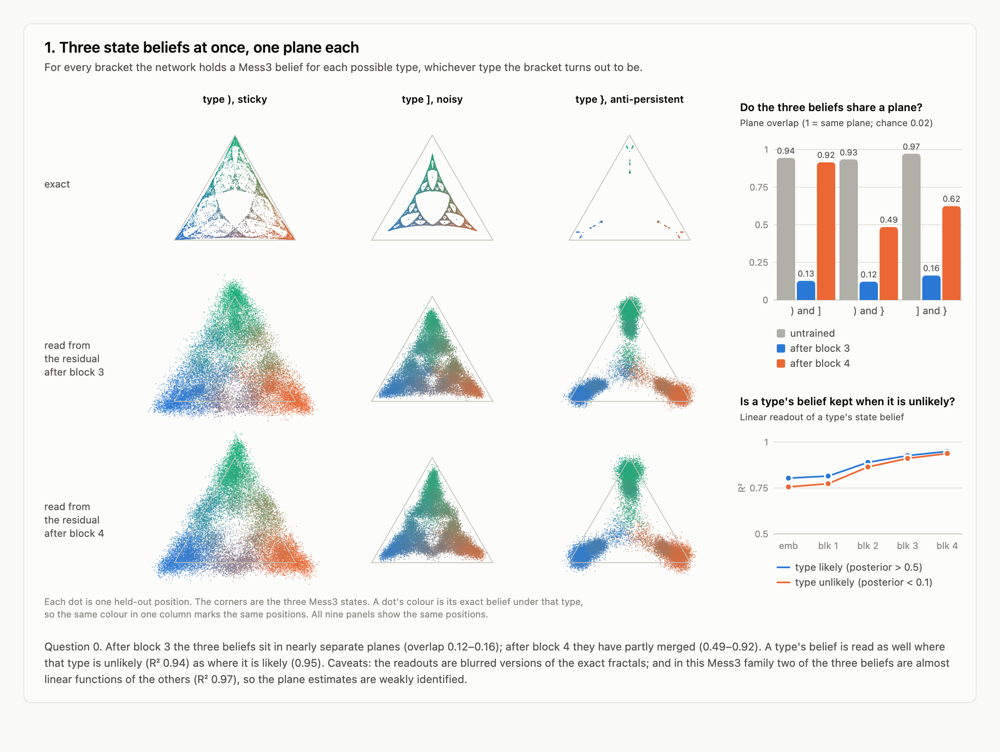
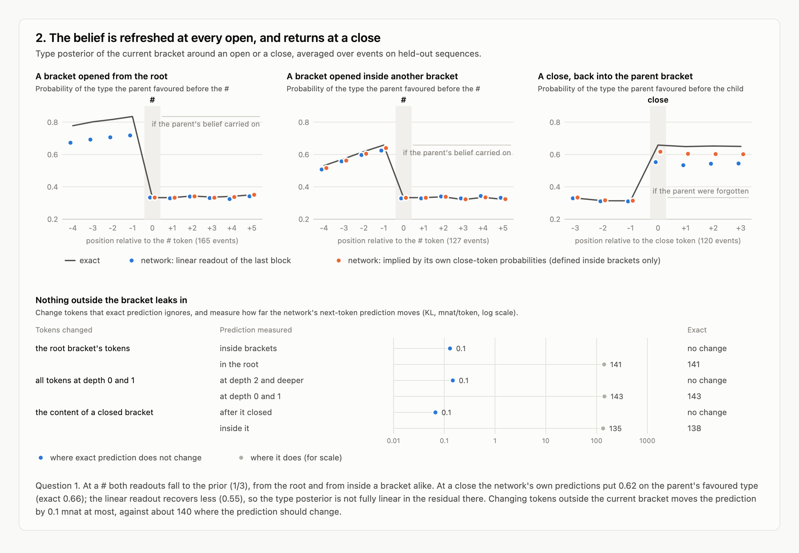
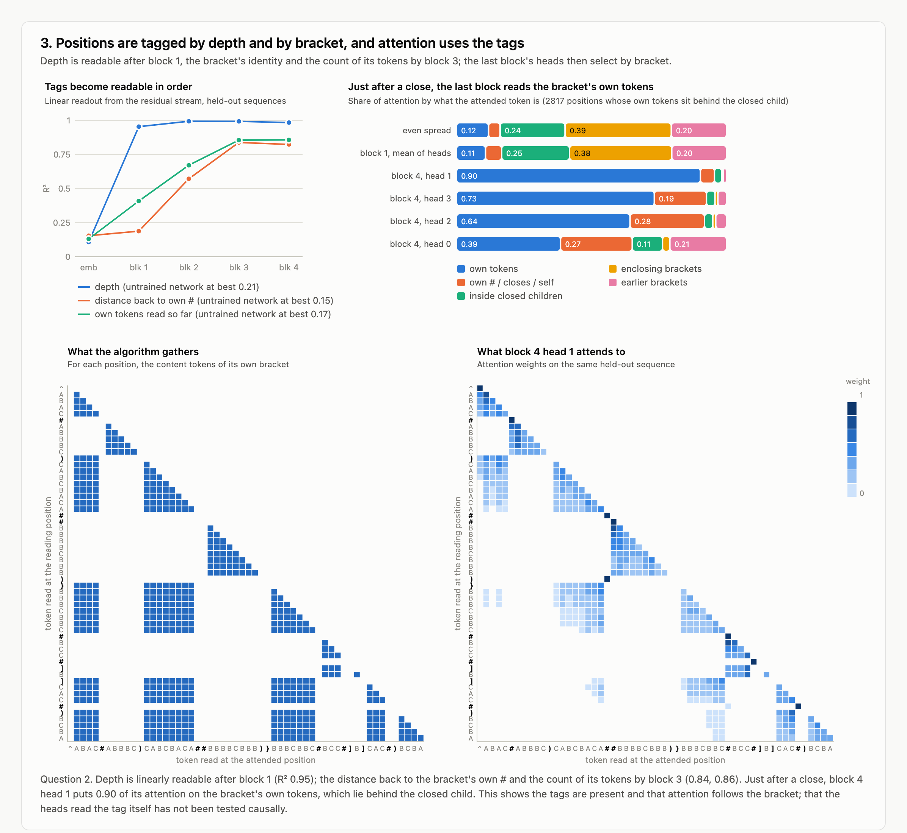

# Predicting a bracketed process without a stack

A proposal for how a transformer does exact next-token prediction on a process that needs a stack, an experiment that tests the proposal step by step, and a design study of which processes test it hardest.

Status: the algorithm is exact (checked against a stack-based Bayes filter on four process families). One small network, trained for 12 minutes on the Mess3 family, has been tested against it; everything under "Pilot" is that one seed. The design study involves no training.

## The process

There is a content vocabulary (`A B C`, or `A B C D`), an open bracket `#`, and K close brackets `) ] }`.

- Each `#` opens a bracket of hidden type, one of K, chosen uniformly.
- The content tokens directly inside a bracket are emitted by a component process chosen by the bracket's type. The K components share the vocabulary.
- A bracket closes with the close token of its type, so the type is revealed only at the end.
- Brackets nest. When a child closes, its parent's component continues from where it stopped.

Example: `#AA#BBB#C}B]A)`. The outer bracket emits `AA…A`, the middle one `BBB…B`, the inner one `C`.

To predict the next token one needs, for the bracket that is currently open, a belief over (type, component state). The full Bayesian state is one such belief per open bracket, so it grows with nesting depth. A recurrent filter keeps them on a stack. A transformer has no stack and no recurrence.

The pilot's process as a PCFG. `R(k,s)` is the root, which never closes; `X(k,s)` is an open bracket; `k` is the hidden type, `s` the hidden Mess3 state, `x` a content token, and `c_k` the close token of type `k`:

```
S       ->  R(k,s)                    1/9
R(k,s)  ->  x R(k,s')                 (1 - p_o) * T_k^x[s,s']
R(k,s)  ->  # X(j,u) R(k,s)           p_o / 9
X(k,s)  ->  x X(k,s')                 (1 - p_o - p_c) * T_k^x[s,s']
X(k,s)  ->  # X(j,u) X(k,s)           p_o / 9
X(k,s)  ->  c_k                       p_c
```

`T_k^x[s,s']` is the probability that the Mess3 of type `k` goes from state `s` to `s'` and emits `x`; `p_o = 0.10`, `p_c = 0.12`; no bracket opens at depth 8. The open token is the same for every type, so every push and pop is visible in the token itself (a visibly pushdown language) but the type is not.

Families of components (`process.FAMILIES`):

| name | components |
|---|---|
| `mess3` | Mess3 with (x, a) = (0.05, 0.85), (0.15, 0.6), (0.45, 0.85). The pilot. |
| `mess3_sharp` | Mess3 with (0.03, 0.9), (0.2, 0.8), (0.45, 0.9) |
| `clock3` | Mess3 (0.05, 0.75) whose state stays, advances by one, or advances by two each step |
| `tomq` | Tom Quantum with β/α = 0.364, 0.839, 2.747 (definition from simplexity). Four content tokens. |
| `fern` | FRDN (`fanizza` in simplexity) with (α, λ) = (2000, 0.49), (1.0, 0.49), (3.0, 0.45). Two content tokens; the belief depends on the count of the second token since the last first one. |
| `mess3_single` | one Mess3: nothing to infer about the type |
| any name + `+open` | K open tokens, so the type is visible from the start |

## The algorithm

Position `i` has read tokens `0..i-1` and predicts token `i`. Call the tokens directly inside one bracket its **thread**. The algorithm uses three operations, each of which one attention head can perform:

| operation | what it does | as attention |
|---|---|---|
| count | running sum over earlier positions | even attention |
| most recent | latest earlier position that matches a key | content match, tie broken by recency |
| gather | sum over earlier positions that share a tag | content match |

Seven steps. Each leaves one quantity at every position.

| step | quantity at position `i` | how |
|---|---|---|
| 1 depth | opens minus closes among the tokens read | count |
| 2 tag | position of the `#` that opened `i`'s bracket | most recent open whose depth equals `depth[i]` |
| 3 index | number of own-thread content tokens read | count over positions with the same tag |
| 4 state | for each type `k`, component `k`'s state belief | gather the thread's tokens, recency counted in thread tokens |
| 5 evidence | at each content token: `log P(token | thread so far, type k)` | local, from step 4 at the previous thread position |
| 6 type | log-posterior of the type | gather the thread's evidence, no decay |
| 7 belief | type posterior × state belief, then the next-token law | local |

Three properties follow.

- **One subspace, any depth.** The belief lives in the same K × S numbers at every position. A `#` does not move it to a new subspace; it changes the tag, and therefore which tokens feed it.
- **Nothing happens at a close.** The depth drops, step 2 returns the parent's tag, and steps 3–7 gather the parent's tokens again. No belief is stored and fetched.
- **Nothing is carried.** Inside a child, no position holds the parent's belief. The parent's tokens stay where they are.

Worked example (`python algorithm.py` prints it). Columns are positions; each has read the token shown (`^` is BOS).

```
read               ^    #    A    A    #    B    B    B    #    C    )    B    }    A
position           0    1    2    3    4    5    6    7    8    9   10   11   12   13
1 depth            0    1    1    1    2    2    2    2    3    3    2    2    1    1
2 tag (own #)      0    1    1    1    4    4    4    4    8    8    4    4    1    1
3 index            0    0    1    2    0    1    2    3    0    1    3    4    2    3
```

Position 10 has just read a close. Its depth is back to 2, the most recent `#` at depth 2 is position 4, so its tag is 4 and it gathers `BBB`.

`algorithm.py` implements these steps with the three operations only. It reproduces the stack filter to 1e-13 or better on 131,072 positions for each of `mess3`, `clock3`, `tomq`, `mess3+open` and `tomq+open`.

## What each position should hold

| the position has just read | depth | tag | index | belief subspace holds |
|---|---|---|---|---|
| a content token | unchanged | unchanged | +1 | own bracket's belief, updated |
| `#` | +1 | this position | 0 | the prior |
| a close | −1 | the parent's `#` | the parent's count | the parent's belief as of before the child |

## Shortcuts, and where each would show

A network could do something cheaper. `algorithm.py` implements the shortcuts below and prices them, in excess loss over Bayes (mnat/token), by position class. For the `mess3` family:

| | all | new bracket with an earlier one at its depth | just read a close | 1–3 tokens after a short child | 1–3 tokens after a long child |
|---|---|---|---|---|---|
| state from the last 4 own tokens only | 0.2 | 0.0 | 0.1 | 0.2 | 0.3 |
| state from the last 2 own tokens only | 3.6 | 0.0 | 3.3 | 4.2 | 4.4 |
| recency counted in positions, not thread tokens | 2.1 | 0.0 | 2.0 | 5.7 | 14.4 |
| depth tag only, no bracket tag | 46.2 | 140.6 | 41.5 | 35.9 | 28.8 |
| no reset at an open (reads enclosing brackets too) | 258.1 | 499.0 | 227.7 | 218.2 | 166.9 |
| no type inference | 46.1 | 4.7 | 44.3 | 56.2 | 53.1 |
| keeps the type, forgets the state at a close | 7.7 | 0.0 | 57.3 | 15.1 | 16.0 |
| forgets the parent at a close | 18.7 | 0.0 | 71.7 | 51.3 | 50.5 |

## The experiment

Train a small causal transformer on the process (`train.py`), then run `validate.py`. It makes six measurements, each with a prediction from the algorithm.

1. **Loss.** Excess loss over Bayes in the position classes above. Prediction: near zero in every column, flat in depth.
2. **Probes.** Linear readout of each step's quantity from the residual after each block, with an untrained network as control. Prediction: the quantities become readable in the order of the steps, and the parent's belief is never readable at a child's positions.
3. **Attention.** For each head, the share of attention by what the attended position is to the current one: own thread, own `#`, inside closed children, enclosing brackets, earlier brackets. Prediction: even-spread heads early (the count), then heads that read only the own thread, including just after a close, when the thread sits behind the child. A second test asks whether recency is counted in thread tokens or in positions.
4. **Patching.** After a close at `q`, change the parent's earlier tokens `R` (all but the last one before the child, at `p`). Overwrite the residual after one block at one set of positions with its value in the changed run, and measure what fraction of the change in `q`'s prediction results. Prediction: nothing travels through the child, or reaches `q` before the last block; `p` carries only its own evidence term, a minority share that the algorithm itself predicts.
5. **Types.** Step 4 keeps a state belief for every type at once. Prediction: each type's state belief has its own subspace, the same at every depth, and it is filled whether or not that type is likely. Measured by one joint regression of the residual on all types' beliefs.
6. **Invariance.** Exact prediction does not depend on the tokens of enclosing brackets, or on the content of brackets that have closed. Change those tokens and measure how far the network's prediction moves. Prediction: not at all. This is the direct test that the belief is refreshed at every open and that nothing leaks back at a close.

## Pilot

One seed on `mess3`: 4 layers, d = 128, 4 heads, context 128, batch 64, 8,000 steps, 12 minutes on a laptop GPU. Evaluated on 768 held-out sequences.

**1. Loss** (mnat/token): 2.5 over all positions; 0.3 in new brackets with an earlier one at the same depth (depth-only tagging would give 140.6); 6.1 just after a close (forgetting the parent would give 71.7); 3.7 and 5.5 after short and long children. By depth 0 to 6: 2.1, 2.2, 2.4, 3.3, 2.7, 3.2, 3.9, a mild rise.

**2. Probes** (R² on held-out sequences):

| quantity | emb | blk 1 | blk 2 | blk 3 | blk 4 | best untrained |
|---|---|---|---|---|---|---|
| 1 depth | 0.11 | 0.95 | 0.99 | 0.99 | 0.98 | 0.21 |
| 2 tag (distance back to own `#`) | 0.15 | 0.19 | 0.57 | 0.84 | 0.82 | 0.15 |
| 3 index | 0.13 | 0.41 | 0.67 | 0.86 | 0.86 | 0.17 |
| 4 state belief per type | 0.78 | 0.80 | 0.87 | 0.91 | 0.93 | 0.79 |
| 5 evidence of the token just read | 0.00 | 0.00 | 0.72 | 0.88 | 0.89 | 0.00 |
| 6 type log-posterior | 0.00 | 0.03 | 0.25 | 0.35 | 0.82 | 0.01 |
| 7 belief of the own bracket | 0.31 | 0.33 | 0.48 | 0.55 | 0.84 | 0.32 |
| belief of the parent bracket | 0.00 | 0.03 | 0.04 | 0.12 | 0.10 | 0.02 |

The order matches the steps: depth after block 1, tag and index over blocks 2–3, evidence from block 2, type and belief at block 4. The state row is weak evidence, because the last token alone predicts most of the state (0.78 from the embedding).

**3. Attention.** All four block-1 heads match even spread to within 0.03. Just after a close with at least three own tokens behind the child (2,817 positions; even spread would put 0.12 on own tokens, 0.24 inside closed children, 0.38 on enclosing brackets):

| head | own tokens | own `#` | inside closed children | enclosing brackets |
|---|---|---|---|---|
| block 4 head 1 | 0.90 | 0.05 | 0.03 | 0.01 |
| block 4 head 3 | 0.73 | 0.16 | 0.03 | 0.01 |
| block 4 head 2 | 0.64 | 0.27 | 0.03 | 0.01 |
| block 3 head 0 | 0.49 | 0.02 | 0.08 | 0.17 |

Recency test on the three block-4 readers (share of attention on the third most recent own token, relative to the second): head 1 gives 0.47 with no child in between, 0.45 with a short child, 0.45 with a long one, as counting in thread tokens predicts. Heads 2 and 3 shift, in opposite directions (0.54, 0.52, 0.67 and 0.52, 0.39, 0.36).

**4. Patching** (712 events; the change moves the Bayes law at `q` by 160 mnat; the network's change has cosine 0.95 with the Bayes change):

| patched after | embedding | block 1 | block 2 | block 3 |
|---|---|---|---|---|
| `R`, the changed tokens | 1.00 | 1.00 | 0.81 | 0.76 |
| `p`, last own token before the child | 0.00 | 0.00 | 0.18 | 0.21 |
| everything else before `q` | 0.00 | 0.00 | 0.00 | 0.00 |
| `q` itself | 0.00 | 0.00 | 0.00 | 0.01 |

The same patch applied to the algorithm after its evidence step gives `R` 0.75 and `p` 0.29. So block 4 reads the parent's information from the parent's own token positions, nothing passes through the child, and the share at `p` is about what its evidence term accounts for.

**5. Types.** After block 3 the three types' state-belief subspaces are nearly separate: overlaps 0.13, 0.12, 0.16 (chance 0.02; an untrained network gives 0.93–0.98, because there everything sits in the last token's embedding). After block 4 they have partly merged: 0.92, 0.49, 0.62. The same type's subspace at depth ≤ 1 and depth ≥ 2 overlaps 0.58, 0.92, 0.98 after block 3 and 0.93, 0.99, 0.99 after block 4. A type's state belief is read as well where that type is unlikely (posterior below 0.1: R² 0.94) as where it is likely (0.95). Caveat: in `mess3` two of the three types' beliefs are almost linear functions of the others (R² 0.97), so these subspaces are poorly identified; `clock3` (0.38) and `tomq` (0.49–0.77) are better for this test.

**6. Invariance** (KL in mnat between the network's predictions before and after the change):

| change | where it should not matter | where it should (exact / network) |
|---|---|---|
| root bracket's tokens | 0.1 at depth ≥ 1 | 140.8 / 140.6 at depth 0 |
| tokens at depth ≤ 1 | 0.1 at depth ≥ 2 | 143.5 / 143.1 at depth ≤ 1 |
| content of a closed bracket | 0.1 after its close | 138.3 / 134.8 inside it |

**Training order.** In the old-format log, the extra loss in resumed brackets over fresh ones was 27 mnat at step 1,000 (forgetting the parent costs 40), 15 at step 1,500 and 3 at the end. So filtering within a bracket was learned before resuming after a close.

**Not explained.**
- Block 2 head 2 puts 0.38 of its attention on the previous position in the thread overall, but just after a close it reads inside the closed child (0.70) and not the thread's previous position (0.02).
- Block 4 head 0 puts 0.21–0.27 on brackets that closed before the current one opened.
- The parent's belief is faintly readable at child positions (0.10, control 0.02), although patching shows nothing passing through the child.
- A probe fitted only at depth ≤ 1 fails at depth ≥ 3, while one probe fitted on all depths works at each. Not followed up.

## Figures from the pilot

`python figures.py runs/pilot_d128_L4_T128_s0` writes `figures/report.html` (self-contained, with the grammar above) and `bash export.sh` turns the figures into PNGs. Numbers behind them are in `figures/data.json`.

**Three state beliefs at once, one plane each.** For every bracket the network holds a Mess3 belief for each possible type.



**The belief is refreshed at every open, and returns at a close.** Read two ways: linearly from the last block, and from the network's own close-token probabilities.



**Positions are tagged by depth and by bracket, and attention follows the bracket.**



## Which processes to train on

A process is informative about a step when skipping that step is expensive, because then a network's loss shows whether the step is done. `design.py` prices every shortcut for every family (512 sequences each, no training). Excess loss in mnat/token; the pilot network reached 2.5, so differences of 5–10 are readable from a run of that size.

| process | all inference is worth | last 4 own tokens only | last 2 | position clock | position clock, after a long child | depth tag only | no type inference | forget state at a close | forget parent at a close |
|---|---|---|---|---|---|---|---|---|---|
| `mess3` | 74 | 0.2 | 3.6 | 2.1 | 13.5 | 48.7 | 46.5 | 56.4 | 72.4 |
| `mess3_sharp` | 127 | 0.2 | 4.7 | 2.5 | 17.1 | 85.7 | 77.9 | 102.3 | 124.7 |
| `clock3` | 97 | 1.7 | 13.6 | 6.6 | 31.6 | 68.0 | 73.9 | 74.2 | 96.8 |
| `tomq` | 115 | 4.4 | 12.5 | 4.5 | 19.5 | 79.0 | 28.6 | 102.5 | 115.0 |
| `mess3+open` | 166 | 0.2 | 3.6 | 1.2 | 8.9 | 6.5 | 16.1 | 76.4 | 161.7 |
| `tomq+open` | 207 | 4.6 | 13.2 | 3.6 | 17.8 | 30.7 | 10.3 | 119.1 | 204.4 |
| `mess3_single` | 217 | 0.6 | 11.3 | 2.5 | 22.8 | 20.4 | 0.0 | 214.3 | 214.3 |

Reading it by step:

- **Step 4, how far back the state gather reaches.** Mess3 needs about three own tokens (using four costs 0.2). Tom Quantum needs about eight (using four costs 4.4). So `tomq` tests whether the gather really runs back through the thread and across children; `mess3` barely does.
- **Step 3, counting in thread tokens.** `clock3` is the hardest: counting in positions costs 31.6 just after a long child, against 13.5 for `mess3`.
- **Step 2, the bracket tag.** Expensive to skip in every hidden-type family (49 to 86 overall). It becomes cheap when the open token shows the type (6.5 for `mess3+open`), so a `+open` network has little reason to build the tag.
- **Steps 5–6, type inference.** Worth 47 to 78 in the Mess3 families, 29 in `tomq`, and absent in `+open`, which makes `+open` the control: the evidence and type probes should find nothing there.
- **The close.** Forgetting the parent costs most when the type is known (162 to 214 in `+open` and single-type processes).

- **Per-type subspaces.** How much of one type's state belief the other types' beliefs predict linearly: 0.97, 0.97, 0.64 in `mess3`; 0.38 for every type in `clock3`; 0.65, 0.77, 0.49 in `tomq`. The lower, the better the per-type subspaces can be told apart.

`mess3_slow` (not shown) is uninformative: all inference is worth 18 mnat and the types are barely distinguishable.

**Coupled brackets** are the first step outside the class. `coupled.py` makes a child's type depend on its parent's, checks that the active bracket's belief is still an exact local statistic (brute-force enumeration, 1.3e-14), and prices observers that chain only a limited number of reads. With the close token revealing the type and the child sharing its parent's type with probability 0.9:

| observer | all | new bracket at depth ≥ 2 |
|---|---|---|
| ignores the coupling | 62.7 | 99.9 |
| uses each child's revealed type | 39.5 | 82.6 |
| + prior from the parent, 1 read down | 11.2 | 38.0 |
| + 2 reads down | 3.3 | 10.8 |
| + 3 reads down | 0.9 | 3.2 |

The prediction was that each extra read costs a layer, so that a sweep over depth would land on this ladder of loss floors. The overnight runs below refuted that for this coupling. At coupling 0.5 the ladder is too short to see (8.4, 0.9, 0.1). If the type is never revealed, every truncation costs under 10 mnat at 0.9 and under 3 at 0.5, and limiting the reads up costs under 1: not worth training.

**Suggested order.** `tomq` (a different geometry and the longest gather), `clock3` (the thread clock), `mess3+open` (the control without type inference), then coupled brackets at 0.9 with revealed types over 3 to 6 layers. Whether each component's belief can be read from one block is checked in the next section.

## Overnight runs (12 November)

20,000 steps, batch 64, context 128, one network per row. Excess loss over Bayes in mnat/token. `python summary.py` prints one line per run from `runs/*.validate.txt`, which hold the six measurements for each.

**Other families** (d = 128):

| run | layers | all | new bracket with an earlier one at its depth | just read a close | 1–3 tokens after a long child | belief readout R², last block |
|---|---|---|---|---|---|---|
| `mess3`, seed 1 | 4 | 1.2 | 0.1 | 2.5 | 2.7 | 0.88 |
| `clock3`, seed 0 | 4 | 1.8 | 0.1 | 4.9 | 3.6 | 0.89 |
| `clock3`, seed 1 | 4 | 2.8 | 0.1 | 6.4 | 7.3 | 0.88 |
| `mess3+open` | 4 | 0.8 | 0.2 | 2.4 | 1.5 | 0.92 |
| `fern` | 4 | 4.6 | 0.1 | 10.2 | 11.9 | 0.75 |
| `tomq`, seed 0 | 6 | 7.0 | 0.1 | 7.7 | 8.4 | 0.67 |
| `tomq`, seed 1 | 6 | 4.7 | 0.1 | 5.9 | 6.4 | 0.72 |
| `tomq` | 4 | 8.0 | 0.1 | 11.5 | 13.5 | 0.65 |
| `tomq+open` | 6 | 4.0 | 0.2 | 5.6 | 5.6 | 0.82 |

- **Brackets are kept apart in every family.** In new brackets that have an earlier one at the same depth the excess is 0.1–0.2, where a depth tag alone would cost 140–250. Changing tokens outside the current bracket moves predictions by at most 0.1 mnat in every d = 128 run.
- **The clock networks count in thread tokens.** After a long child they are at 3.6 and 7.3; counting in positions would cost 31.
- **Per-type subspaces are clearer here than in the pilot.** One block before the last, the overlap between two types' planes is 0.07–0.12 in `clock3` and 0.00–0.12 in `tomq` (chance 0.02), and the same type's plane at shallow and deep positions overlaps 0.96–0.99. After the last block the `clock3` planes have partly merged (0.43–0.44).
- **Patching matches the algorithm's own split.** After a close, the share of the effect carried by the parent's earlier tokens and by the last position before the child is 0.79 / 0.22 in `fern` (algorithm 0.79 / 0.22), 0.79 / 0.18 in `mess3` (0.75 / 0.29), 0.58 / 0.25 in `clock3` (0.73 / 0.32), 0.66–0.72 / 0.21–0.30 in `tomq` (0.82 / 0.18), and nothing passes through anything else.
- **Tom Quantum is the hardest.** Six layers beat four after a close (8.4 against 13.5 after a long child) but the networks are still 5–7 mnat from Bayes, worst in the root (7–11 at depth 0), and the belief reads only 0.65–0.72 from the last block.
- **The type-at-open control is confounded by the root.** The root's type is still hidden, and the per-token evidence is still readable in `mess3+open` (0.84).

**Width sweep** (`mess3`, 4 layers, two seeds). A full depth-8 stack of beliefs is 81 numbers.

| d | all | by depth 0, 3, 6 (seed 0) | by depth 0, 3, 6 (seed 1) | largest leak |
|---|---|---|---|---|
| 128 | 1.2 | – | 1.1, 1.3, 1.7 | 0.0 |
| 64 | 2.3, 2.2 | 1.9, 3.0, 3.7 | 1.8, 2.5, 3.4 | 0.2 |
| 32 | 4.5, 5.0 | 3.6, 5.6, 6.6 | 3.8, 5.8, 8.2 | 0.3 |
| 16 | 9.5, 10.0 | 6.2, 9.7, 20.0 | 6.8, 10.7, 18.0 | 0.6 |

At d = 32, less than half of what a full stack needs, the network is within 4–8 mnat of Bayes at every depth, where forgetting the parent costs 19 overall and 73 just after a close. The loss does rise with depth as width shrinks: by a factor of two at d = 32 and three at d = 16. `clock3` at d = 32 is much worse (14.5 overall, 33 after a long child).

**Coupled brackets** (child shares its parent's type with probability 0.9; `coupled_train.py`):

| | all | new bracket at depth ≥ 2 | just read a close |
|---|---|---|---|
| observer with 0 reads of the parent | 38.9 | 79.7 | 8.0 |
| 1 read | 11.9 | 37.1 | 2.3 |
| 2 reads | 3.6 | 11.0 | 0.7 |
| 3 reads | 1.1 | 3.3 | 0.2 |
| network, 2 layers | 2.6 | 3.3 | 5.2 |
| network, 3 layers | 2.0 | 2.4 | 3.9 |
| network, 4 layers | 1.4 | 1.7 | 2.8 |
| network, 6 layers | 0.8 | 0.9 | 1.8 |

The prediction that loss would step down a ladder as layers allow more chained reads is wrong here. A two-layer network is already below the two-read floor, and in new brackets at depth ≥ 2 it is at 3.3 where two reads give 11.0. The likely reason, not yet tested: with this coupling a type is either copied from the parent or redrawn, so the evidence of all enclosing brackets about a shared type simply adds, and one gather over the enclosing brackets' tokens replaces the chain. A coupling whose steps do not commute would be needed to test the layer cost.

## Is each component's belief readable from one block?

The probes above read a belief from one block's output. That only makes sense for components whose belief is linearly readable from a single block of a trained network, which is known to fail for RRXOR (Shai et al., arXiv 2405.15943). `flat.py` trains a network on one component alone, on flat sequences with no brackets, and reads the belief from each block. d = 64, 4 heads, context 32, one seed each.

Four layers, 15,000 steps:

| component | excess loss, mnat/token | readout R², last block | all blocks together | untrained, last block |
|---|---|---|---|---|
| Mess3 (0.05, 0.85) | 0.05 | 0.998 | 0.999 | 0.876 |
| clock (Mess3 advancing by one) | 0.10 | 0.995 | 0.998 | 0.669 |
| fern (2000, 0.49) | 0.01 | 0.990 | 0.998 | 0.601 |
| Tom Quantum, β/α = 0.364 | 0.35 | 0.982 | 0.995 | 0.668 |
| Tom Quantum, β/α = 2.747 | 1.44 | 0.964 | 0.982 | 0.440 |
| Tom Quantum, β/α = √51 | 4.20, still falling | 0.622 | 0.628 | 0.128 |
| RRXOR | 0.01 | 0.669 | 0.799 | 0.091 |

- RRXOR is the control: the network solves it, yet the belief is not readable from one block.
- Mess3, the clock, fern and Tom Quantum at the settings used in the `tomq` family pass. Tom Quantum at β/α = √51 (reported as the Bloch Walk setting of arXiv 2507.07432) does not at this budget; its belief has a slowly decaying component that changes sign every step.

A stricter question, whether a one-layer network can hold the belief at all (20,000 steps):

| component | excess loss, mnat/token | readout R² after the layer |
|---|---|---|
| Mess3 (0.05, 0.85) | 0.15 | 0.996 |
| clock | 0.21 | 0.995 |
| Tom Quantum, β/α = 0.839 | 0.19 | 0.986 (the last token alone gives 0.971) |
| fern (2000, 0.49) | 0.73 | 0.921 |
| Tom Quantum, β/α = 0.364 | 2.47 | 0.902 |
| Tom Quantum, β/α = 2.747 | 11.5 | 0.859 |
| Tom Quantum, β/α = √51 | 8.4, on a plateau | 0.240 |
| RRXOR | 54 | 0.241 |

For Tom Quantum at β/α = 2.747 one layer is a real limit: three times the training gives 7.2 mnat and 0.82, while two layers give 4.0 mnat and 0.93. So a bracket network on `tomq` needs layers for the component's own filtering on top of the bracket bookkeeping; six is a safer choice than the pilot's four.

## Not yet done

- More seeds. The pilot is one.
- Any training on a family other than `mess3`.
- Width below 72, the size that would hold a full depth-8 stack of beliefs. The pilot's d = 128 does not test whether the per-token dimension is bounded.
- Fewer and more layers. The algorithm suggests about four attention steps.
- A hand-built transformer that implements the seven steps.
- Causal tests of the tag: overwrite one bracket's tag with another's and check that the readers switch threads. Head ablations by step. Whether the type readout equals the sum of the per-token evidence readouts.
- Depths beyond those seen in training.
- Coupled brackets in `train.py` and `validate.py`; `coupled.py` is a standalone study.

## Files

| file | what |
|---|---|
| `process.py` | components and families, sampler, stack-based exact filter (the ground truth), observers that forget at a close |
| `algorithm.py` | the seven steps with attention-style operations; the shortcuts; position classes; run it for the self-check, the worked example and the shortcut table |
| `model.py` | the transformer, and a hand-run forward pass that returns residuals and attention and takes patches |
| `train.py` | training (`--process NAME`), with excess loss by position class at each eval |
| `validate.py` | the six measurements |
| `figures.py`, `export.sh` | figures from a trained run, as a self-contained HTML report and PNGs |
| `flat.py` | one component alone on a flat sequence: is its belief readable from one layer |
| `design.py` | shortcut prices across families |
| `coupled.py` | coupled brackets: exactness check and the cost of limited reads |
| `runs/` | training logs; checkpoints are not committed |

```
python algorithm.py [family]
python design.py
python coupled.py
python train.py --process mess3 --steps 8000 --batch 64 --device mps
python validate.py runs/pilot_d128_L4_T128_s0
```

Needs numpy and torch. Open and close rates are 0.10 and 0.12; depth is capped at 8.
